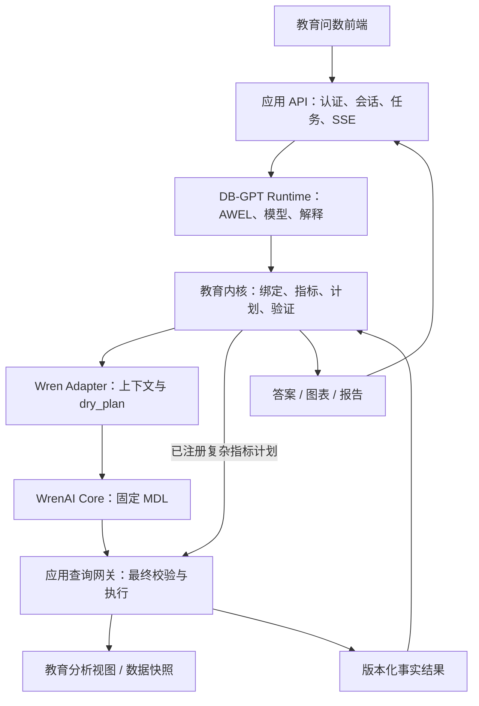

# DB-GPT + WrenAI + 独立教育指标内核：V2 融合方案

编写日期：2026-10-31。状态：架构提案，尚未部署或进行三方集成测试。

2026-11-01 演进：集团通用模块与经营财务扩展采用[集团数据与 AI 底座方案](group-data-ai-platform-modular-architecture.md)。本文作为教育领域的详细设计依据；其中教育指标内核对应集团平台的通用指标引擎与 education 领域包。

2026-11-02 选型更新：当前接入路线见[WrenAI 接入指南](wrenai-integration-guide.md)，不新增 DB-GPT 运行时；本文的三方融合架构作为历史方案保留。

目标：重新建设问数与报告底层，优先解决统计口径错误、过滤条件丢失、重复计数、排名范围错误、正文与图表数字不一致。

## 1. 架构决策

采用“三层能力、一个指标事实来源、一个查询执行入口”的设计：

| 层 | 主要职责 | 输入和输出 |
|---|---|---|
| DB-GPT | 模型调用、理解问题、检索业务资料、AWEL 工作流、解释结果 | 自然语言 → 候选 QuerySpec；事实结果 → 解释 |
| WrenAI Core | 逻辑模型、字段与关系映射、语义上下文、语义 SQL 规划 | 语义 SQL + 固定 MDL → 目标数据库 SQL |
| 教育指标内核 | 指标定义、实体绑定、合法维度、计算与聚合规则、排名、结果校验 | 已确认 QuerySpec → 认证计划 → MetricResult |
| 应用查询网关 | 权限、最终 SQL 校验、连接与事务、执行、结果存储、审计 | 已授权执行计划 → QueryResult |

教育指标内核是独立 Python 包，通过自有数据契约与框架适配。其测试和计算逻辑可以脱离 DB-GPT、WrenAI 运行。初期内核与应用 API 同进程部署，避免把每项能力拆成服务。

融合方式是适配器组合。上游代码作为固定版本依赖；确需修改上游时使用有测试的小补丁，并记录升级处理方式。

## 2. 运行架构



图中为逻辑调用关系。内核、查询网关、报告渲染属于应用服务；Runtime 和 Semantic Service 通过内部接口调用它们。

建议三类运行单元，使用独立依赖锁文件：

| 单元 | 内容 | 数据库权限 |
|---|---|---|
| application-api | FastAPI、认证授权、教育内核、查询网关、结果与报告接口 | 按功能隔离的系统库和业务只读连接 |
| agent-runtime | DB-GPT Core、AWEL、自定义工具适配器、异步任务执行 | 通过应用内部接口读写任务状态；无教育业务库连接凭据 |
| semantic-service | WrenAI Core SDK、MDL 加载、上下文读取、dry_plan 封装 | 规划模式无业务库凭据；实体候选由应用受控接口提供 |

系统 PostgreSQL 存任务、版本、审计及结果元数据；Redis 承担队列、事件和通知；报告文件使用文件存储或对象存储。任务状态以 PostgreSQL 为准。业务库与系统库连接分离。

依赖隔离有现实依据：DB-GPT 当前部分 extras 声明 FastAPI <0.113 或 NumPy <2；现有项目声明 FastAPI >=0.115.12、NumPy ==2.3.5。Wren 当前 SDK 还存在独立的 SQLGlot、Arrow 和加密库依赖约束。原型阶段应分别求解依赖与验证镜像，避免在原项目环境直接叠装所有 extras。[DB-GPT 依赖声明](https://github.com/eosphoros-ai/DB-GPT/blob/main/packages/dbgpt-core/pyproject.toml)、[Wren 依赖声明](https://github.com/Canner/WrenAI/blob/main/core/wren/pyproject.toml)

## 3. 一个指标事实来源

教育内核维护版本化指标注册表，作为计算规则的唯一来源。Wren MDL、可检索指标描述、工具参数约束、展示格式由注册表生成或引用相同定义。

```text
教育指标注册表 + 规范数据模型 + 已注册计算提供者
    ├── QuerySpec 校验规则
    ├── Wren MDL / 认证视图映射
    ├── 工具描述和指标说明
    ├── 确定性编译器 / 复杂统计执行器
    └── 标准用例、输出字段、单位与舍入规则
```

下例是自有注册表草案，不是 Wren 原生 YAML。实际分母、缺考处理、阈值来源需由业务确认后启用。

```yaml
id: edu.undergraduate_reach_rate
version: 1
grain: student_exam_track
required_dimensions: [exam_batch_id, track]
optional_dimensions: [school_id, class_id, district_id]
score_basis: six_subject_total
population_policy: reference_policy_v1
threshold_provider: fraction_bar_v1
provider: reach_rate_v1
aggregation:
  kind: ratio
  numerator: reached_count
  denominator: candidate_count
  rollup: sum_numerator_over_sum_denominator
  zero_denominator: null
format:
  unit: percent
  decimals: 2
```

跨学校达线率由合计达线人数除以合计参考人数计算；跨班均分由有效分数合计除以有效人数计算。排名、百分位、中位数、去重人数必须声明重新计算方式，不能作为普通可加数值随意汇总。部分群体可能重叠，去重人数也不能简单相加。

基础可表达的度量由注册表投影到 MDL；复杂逻辑由内核计算提供者或经审核的版本化 SQL 视图实现，Wren 引用其模型。复杂指标的业务公式仍由内核维护。

发布物使用 bundle_id 绑定：指标版本、模型版本、MDL 哈希、计算提供者版本、所需数据库视图版本。测试通过后切换发布指针；请求固定 bundle_id，避免运行中加载到不同版本。

## 4. 规范数据模型

先将现有 tb_score、tb_score_overview、tb_score_indicator 等表映射成规范分析视图，再决定物理存储迁移。

建议模型包括考试批次、分科考试、学校、考试时点班级、匿名学生、科目、分科成绩、考试总览和分数线。考试批次与分科考试使用不同标识。

每个模型明确：业务唯一键、粒度、关联基数、有效时间、数据批次、重复记录处理方式。学生班级与学校归属按考试时点确定，避免学生转班后改变历史统计。

成绩数据至少区分：有效成绩、缺考、未选考、无效记录、状态未知。真实零分可作为有效成绩；历史数据若只有一个 0 值且无法确定含义，保留 unknown 状态及业务约定，不能推断出缺失事实。

原始分、赋分、三门总分、六门总分分别建模。优先关联稳定 ID，名称与别名用于检索和展示。导入端增加唯一性、完整性和汇总对账，避免将数据错误全部归因于模型。

## 5. 自有数据契约

以下 QuerySpec、接口名称和结果类型均为拟建设的应用协议，不是上游已提供的统一接口。

### 5.1 QuerySpec

模型只能提交候选需求。服务端完成实体查证、范围授权、口径绑定后生成可执行版本。

```json
{
  "task": "metric_query",
  "metrics": [{"id": "edu.undergraduate_reach_rate", "version": 1}],
  "exam_batch_id": "exam_demo",
  "target_scope": {"school_id": "school_demo"},
  "comparison_scope": null,
  "filters": {"track": "physics"},
  "group_by": [],
  "population_policy": "reference_policy_v1"
}
```

扩展字段包括科目、排序、Top-N、并列规则、报告类型和展示对象。显式定义兼容矩阵：例如当前达线指标若仅支持六门总分，单科条件必须转入相应指标或返回 unsupported，不能忽略。

user_id、workspace_id、角色、访问范围、权限版本和任务签名属于服务端 ExecutionContext，不在模型可填写的 QuerySpec 中。内部调用每次重新确认上下文与任务的关联。

每个条件保存来源：本轮显式、历史继承、用户确认、已批准默认值。默认值对用户可见；改变学校、考试或比较范围时，相关继承条件重新校验。

### 5.2 执行计划

计划包含依赖步骤、必需步骤、编译策略、所需数据版本及预期结果字段。认证任务由内核从 QuerySpec 确定性编译，模型负责提出候选需求和解释。

策略分为 semantic 和 registered_native：前者经 Wren 规划，后者仅允许调用已注册的复杂指标提供者。Wren 规划失败返回明确错误，不能自动降级到原始物理表自由查询。

SQL 参数优先绑定。Wren 转换是否保留目标驱动占位符属于原型必测项；若不支持，由类型化编译器安全生成表达式并在规划后重新校验，禁止直接拼接用户文本。

### 5.3 MetricResult 与报告

结果包含 metric_id、metric_version、value、unit、numerator、denominator、sample_count、effective_scope、bundle_id、data_snapshot_id、quality_flags、provenance_ref 和 result_id。

状态区分 needs_clarification、unsupported、no_data、partial、failed、success。执行错误不能转换为 0，无数据不能转换为“表现较差”。必需步骤失败时禁止标记报告完整成功。

报告由 ReportSpec + ResultBundle + ChartSpec + 已批准模板生成。核心数字、排名和变化幅度通过 result_id / fact_ref 填入。模型生成结构化说明与证据引用；数值引用必须校验，因果解释与教学建议单独标注其依据和适用范围。

## 6. DB-GPT 与 Wren 的接入方式

### 6.1 DB-GPT Adapter

统一使用 AWEL 编排顶层流程：理解 → 补槽 → 绑定 → 授权 → 计划 → 执行 → 验证 → 展示。模型调用不是每个节点的必需步骤。

新增自有工具：list_education_metrics、resolve_entities、validate_query_spec、run_metric_plan、get_result_bundle。工具包装应用内部接口，具体 FunctionTool / Operator 用法以锁定上游版本为准。[DB-GPT 工具扩展源码](https://github.com/eosphoros-ai/DB-GPT/blob/main/packages/dbgpt-core/src/dbgpt/agent/resource/tool/base.py)、[AWEL 源码](https://github.com/eosphoros-ai/DB-GPT/blob/main/packages/dbgpt-core/src/dbgpt/core/awel/__init__.py)

工具集合由服务端按任务授权。教育查询 Runtime 只获得受控查询工具和已授权结果句柄。上下文传递关键指标、样本量和结果引用，完整数据保存在结果层。

业务资料检索由 DB-GPT 负责；模型、字段、关系和审核查询示例的语义上下文由 Wren Adapter 负责。两类检索分别管理，引用同一 bundle_id 对应的指标说明，避免重复维护指标事实。

### 6.2 Wren Adapter

建议自建三个内部能力：get_context、list_models、compile_semantic_sql。对 DB-GPT 暴露的是经过授权筛选后的包装能力。

当前 WrenEngine 源码提供 dry_plan(sql)，可在不连接数据库的情况下返回展开后的目标方言 SQL；因此可以部署为无业务库凭据的规划服务，将执行统一交回应用查询网关。[WrenEngine 源码](https://github.com/Canner/WrenAI/blob/main/core/wren/src/wren/engine.py)

生产规划启用严格模型范围和受控函数策略。输入语义 SQL、输出物理 SQL 都检查；MDL、ref_sql 和模型视图只能来自审核后的发布物。dry_plan 表明查询可被规划，不构成业务口径正确性的证明。

使用直接 SDK 封装，避免为此额外引入一套 LangChain / LangGraph Agent 循环。无需让用户同时操作 DB-GPT 与 Wren 的产品界面。

## 7. 三类任务路径

| 类型 | 编译和执行 | 结果要求 |
|---|---|---|
| 认证事实问数 | 内核选定指标与范围 → Wren 展开模型或已注册复杂计划 → 网关 | 数字、样本、口径与来源可复算 |
| 固定分析报告 | 内核生成有依赖的认证指标计划 → 批量执行与校验 → 模板 | 全部必需步骤状态明确，正文图表共享事实 |
| 开放探索 | DB-GPT 结合 Wren 上下文提出查询 → 受控模型规划 → 网关 | 标记探索状态；不会自动成为认证口径 |

开放探索仅开放允许的维度和模型。遇到未定义统计口径时先追问或返回不支持。经业务审核、增加标准用例并发布指标版本后，探索能力才能升级为认证能力。

均分先覆盖按考试、校、班、科目的查询；达线覆盖选科与分数线对应关系、合法分母、跨校汇总；排名覆盖总体、并列、目标筛选和比较范围。这三类作为首个纵向切片。

## 8. 查询网关、权限与一致性

所有业务数据读取均进入网关，包括实体候选、明细预览、认证指标、探索查询和报告。网关绑定用户、工作空间、数据源、权限版本和发布物版本；模型不能选择更高权限连接。

执行前后分别检查：只读和对象允许列表、最终查询对象、权限约束、结果字段、有效范围、返回完整性及超时。可用数据库 RLS、授权视图或受控函数作为执行层约束；具体连接和事务行为通过集成测试确认。语义校验异常返回失败，不能记录告警后继续查询。

排名显式区分 target_scope、comparison_scope 和 access_scope。本班全市排名不能先把比较池过滤成本班。跨校比较通过有授权依据的汇总视图、预计算排名或受控服务能力完成，仅返回允许的目标结果与对照汇总；扩大比较池不能扩大用户可见明细范围。

缓存键包含查询规范、工作空间、授权范围指纹、权限版本、bundle_id 和数据版本。用户撤权后旧结果与报告重新检查访问权。审核查询示例不保存敏感明细，新查询不会自动写入共享记忆。

明细展示行数限制与指标总体分开处理。认证指标在数据库全量聚合；禁止用截断后的预览样本计算全量均分或达线率。

同一报告尽量在一次短时只读一致性事务中执行所需查询；较长任务使用已发布数据快照。追问等待期间不持有数据库事务。跨数据源若无法获得一致快照，记录各来源版本与时间，不标记为同一时点数据。

## 9. 任务状态和故障处理

应用维护 run_id、节点状态、输入与结果引用、候选追问、版本信息、取消状态和幂等键。SSE 按 event_id 可重连读取。等待用户回复的状态持久化，worker 可在节点边界恢复；AWEL 的具体恢复方式需原型验证，应用状态存储不能仅依赖进程内事件。

网络临时错误允许有限重试；口径错误、权限错误、模型字段不支持返回明确状态。重试不改变已确认的学校、考试、分母或分数类型。报告写入和结果发布使用幂等键，防止重复产出。

## 10. 仓库与迁移边界

建议先在同一仓库建设 v2/，形成独立入口、锁文件与部署配置：

```text
v2/
  apps/application_api/       # API、权限、任务、查询网关、报告
  apps/agent_runtime/         # DB-GPT + AWEL + 自有工具
  apps/semantic_service/      # Wren SDK + 语义服务包装
  packages/education_kernel/ # 指标、实体、编译、质量校验
  packages/contracts/        # 自有协议与契约测试
  semantic/                  # 模型源定义、MDL 生成器和发布物描述
  evals/                     # 固定数据、标准结果、真实问题、独立验收集
  deploy/                    # 各运行单元镜像和配置
```

当前工具与统计代码按指标逐个审核迁入内核；模板按新数据契约逐个适配；权限模块迁移时进行行为对照。旧的 agent_runner、重复路由、自然语言计划、摘要补数字等实现由新链路逐项替代。

前端统一问数入口，根据系统识别的任务展示进度、当前理解条件、口径、结果和报告。对外使用 /api/v2 协议；旧 SSE 事件通过临时兼容层映射。历史报告标注历史生成版本，不自动宣称其数字经新内核验证。

## 11. 验收和实施顺序

| 阶段 | 交付 | 进入下一阶段的条件 |
|---|---|---|
| M0：口径与数据基线 | 均分、达线、排名的人工确认定义、固定快照、标准结果 | 数据粒度、分母、缺考与零分含义有明确记录 |
| M1：融合原型 | 一条问题 → DB-GPT → 内核 → Wren dry_plan → 网关 → 结果链路 | 三套依赖可部署，接口可调用，SQL 方言与权限兼容 |
| M2：认证指标内核 | 指标注册表、模型投影、发布物、三类指标完整用例 | 固定数据上的标准结果、维度保留、权限用例全部通过 |
| M3：会话与报告 | 持久化任务、多轮条件、图表、首批固定报告、导出 | 必需任务失败准确呈现，正文表格图表数字一致 |
| M4：灰度与迁移 | 真实问题对比、性能统计、业务验收、功能逐项迁移 | 达到约定正确率与时延目标，有可执行回滚方案 |

建议首批收集 100–200 个真实问题，留出独立验收集，避免仅针对开发题调整规则。覆盖口语改写、多轮修改、重复成绩、真实零分、缺考、空数据、同名班级、学校人数差异、并列和越权请求。

确定性测试以结果值、分子、分母、范围和粒度为准；浮点容差与舍入按指标规定。用性质测试补充：互斥完整分组的分子分母可回汇、跨校率等于合计比率、关联不应扩大业务键数量、目标过滤不应改变已定义的排名总体。报告测试核对事实引用与结果来源。

发布门槛建议：认证指标标准用例 100% 通过；权限与隔离用例 100% 通过；必需条件保留及核心数字展示一致性用例 100% 通过；真实问题端到端正确率初始目标 >=95%，同时披露直接回答率、追问率和覆盖率。目标需基线确认，不能通过大量拒答或追问掩盖效果。

原型需重点验证五项：Wren 对当前 PostgreSQL 聚合、CTE 与窗口函数的规划兼容；编译后参数处理；复杂指标与 MDL 的发布联动；排名比较池和用户权限同时正确；DB-GPT 自定义工具、SSE、暂停恢复与应用任务状态的衔接。

排期按阶段验收拆分。若配置两名后端、一名前端和持续参与的业务验收人员，可先按 6–8 周规划核心版本；全量历史报告迁移需完成清单盘点后另估。本估算以数据可用、关键接口兼容为前提。

## 12. 版本、许可与原型结论

本方案核对了当前上游 main 的接口源码及 DB-GPT 发布页。main 源码、正式发布包和实际安装版本可能不同。原型选定 tag/commit 后记录包版本、依赖锁、镜像摘要和接口测试结果；MDL 发布物同时固定所需引擎版本。

DB-GPT 仓库采用 MIT。Wren 当前 core、sdk 等路径采用 Apache-2.0，文档为 CC BY 4.0，发布包以其元数据为准。本方案权限能力由应用查询网关实现；当前 Wren README 将用户组与行列权限等能力列在商业功能边界中。[DB-GPT 许可](https://github.com/eosphoros-ai/DB-GPT/blob/main/LICENSE)、[Wren 许可范围](https://github.com/Canner/WrenAI/blob/main/LICENSE)、[Wren 功能边界](https://github.com/Canner/WrenAI#open-core-whats-oss-whats-commercial)

本文交付架构与验收方案，尚未证明上游依赖能够共同运行、现有业务 SQL 能全部编译或真实问题达到目标正确率；这些由 M1–M4 的原型、集成测试和业务验收分别验证。
