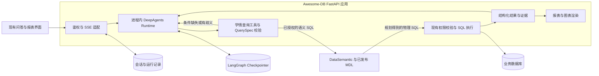

# DeepAgents 与 DataSemantic 改造方案

适用范围为 `edu-rev` 分支。DeepAgents 作为 Python 库完整接入现有 FastAPI 应用，依赖升级和旧 Agent runtime 替换随同一个应用版本发布。DataSemantic 通过 HTTP 提供语义规划，首批选择单个已授权教育数据源，覆盖学校与班级科目均分、及格率。现有 WrenAI 接入指南中的权限与查询网关设计可继续参考。本文为设计评审稿，未执行依赖安装、真实库对账或生产验证。

**原数据权限体系按现有实现直接复用。** 改造范围是 Agent 编排和指标查询来源。数据权限管理 API、权限配置与存储、角色豁免、工作空间与数据源校验、教育范围、SQL 行列权限和脱敏逻辑均沿用本项目实现。新查询形态通过原权限链路验收后才启用。

## 1. 目标架构

| 层 | 职责 |
| --- | --- |
| DeepAgents | 在 FastAPI 进程内接收消息、管理会话上下文、调用工具、在中断点等待与恢复、组织回答。主 Agent 统一承担入口，报告工具按职责注册。 |
| DataSemantic | 发布逻辑模型、关联、计算字段与语义视图，将语义 SQL 规划为目标方言 SQL。独立部署，通过 HTTP 接入。 |
| Awesome-DB 宿主 | 复用现有身份、工作空间、数据源和行列权限实现。负责语义发布物绑定、实体查找、业务请求校验、SQL 执行、审计和报表交付。 |

现有 `/api/v1/chat/chat-stream` 分流到 `legacy`、单 ReAct Agent 或 team。team 已用 LangGraph 做部分编排，内部仍调用自建 Agent 和教育处理链。教育澄清通过 `ChatAgentRun` 的等待状态在下一次请求重建上下文，`question` 工具则在当次 SSE 内等待进程中的 `QuestionManager`。这两条路径在新运行时统一到持久化中断。 [聊天入口](../src/chat/api/chat.py) · [现有 Agent Runner](../src/chat/service/agent_runner.py) · [现有 question 工具](../src/agent/resource/tool/question.py)

## 2. 用 DeepAgents 替换运行时

### 接入和依赖

- 在聊天服务增加进程内 `DeepAgentsRuntime` 适配器，封装 `create_deep_agent`、流式调用、中断恢复和事件转换。在 FastAPI `lifespan` 初始化 Agent、模型适配器与 Postgres checkpointer 连接池，关闭时释放资源。查询工具直接调用应用服务，用户与数据源信息由鉴权入口注入运行上下文。SSE 继续映射 `step`、`tool_call`、`tool_result`、`result`、`chart`、`summary`、`done` 等界面需要的事件。 [FastAPI 入口](../src/main.py)
- 在本项目一次性升级依赖。当前应用锁定 LangChain 与 LangGraph `0.3.x`，DeepAgents 当前源码要求 LangChain `1.x`。选定 DeepAgents 正式发布版本，在同一个 `pyproject.toml` 中更新 LangChain、LangChain Core、LangGraph、OpenAI 等 provider 包与 Postgres checkpointer，检查 `langchain-community`、`langchain-huggingface` 等扩展的实际用法后按需升级或清理，统一重解并提交 `uv.lock`。修复 `src/llm/` 和保留调用中的消息、工具与流式事件适配，验证 `uv sync --locked`、生产镜像构建、应用启动及主用模型的工具调用和用量记录。 [当前依赖](../pyproject.toml) · [DeepAgents 依赖声明](https://github.com/langchain-ai/deepagents/blob/main/libs/deepagents/pyproject.toml) · [LangChain v1 迁移指南](https://docs.langchain.com/oss/python/migrate/langchain-v1)
- Agent 入口在同一发布中统一走 DeepAgents。盘点 `agent`、`team`、`legacy`、CLI 和 MCP 的实际调用，分别接入新运行时或明确映射为无需 Agent 的领域服务。迁移必要的工具、图表、报告与审计，直接调用已有鉴权和范围检查。移除旧 Agent 入口、AWEL 和 team graph 等已无调用的编排代码及配置。存量客户端的 `agent_mode` 可暂时作为兼容输入映射到新入口。
- 首批仅向模型暴露受控的查模型、查实体、查指标与生成报告等工具。按锁定版本配置工具清单，验收实际暴露的默认文件、shell、委派和记忆能力，模型上下文仅使用本任务所需的信息。 [DeepAgents 上下文能力](https://docs.langchain.com/oss/python/deepagents/context-engineering)

### 会话与上下文

| 数据 | 归属与生命周期 |
| --- | --- |
| `conversation_id`、`run_id`、业务状态与展示记录 | 宿主。一次提问对应一次 run，一次 run 可经历多次追问。复用 `chat_agent_run` 并补充运行时版本、线程映射和待回复状态。 |
| `thread_id` 与图状态 | LangGraph。由宿主在授权后分配，按工作空间、会话、数据源和运行时版本隔离。同一新会话复用一个稳定线程，每个线程同时只推进一个 run。生产使用持久化 checkpointer。 |
| 已确认的查询条件 | 图状态保存结构化 `QuerySpec` 摘要及条件来源。DeepAgents 管理消息窗口与摘要。追问和续问继承已确认项，本轮明确修改项覆盖旧值，依赖条件随之重新绑定。 |
| 用户权限、模型与数据源授权 | 宿主服务在运行、恢复和查询时重新校验。模型摘要中缓存的范围、名称或工具结果只能作为上下文。图状态只保存必要字段和结果引用。 |

既有历史继续由会话接口提供。发布切换前让旧运行中的等待任务完成，剩余等待任务显式取消并提示重新提问。已有会话首次进入新运行时，仅导入必要且仍有权查看的历史摘要或已确认条件。模型版本或权限变化后重新解析相关条件，结果引用读取时再次授权。 [现有运行记录](../src/chat/models/agent_run.py) · [现有多轮上下文](../src/chat/service/conversation_context.py) · [LangGraph 持久化](https://docs.langchain.com/oss/python/langgraph/persistence)

### Ask Human 与恢复

1. 查询校验器返回缺失或歧义项。候选来自受权限约束的考试、学校、班级等字典，Agent 可以组织问法。`ask_human` 以 LangGraph `interrupt()` 暂停，载荷包含原因、问题、候选 ID、回答类型与有效期。确认高风险动作时可单独接入 DeepAgents 的 `interrupt_on` 工具审批机制。
2. 图 checkpoint 成功后，宿主将中断投影为 `waiting`，记录 `run_id`、`interrupt_id`、`request_id`、所有者和有效期。沿用前端 `question.asked` 事件并为 `done` 增加可选运行状态。等待时结束本次 SSE，页面刷新后从宿主读取待回复卡片。
3. 复用 `/chat/question/{request_id}/reply` 和 `/reject`，统一读取持久化的中断记录。回复端点验证用户、会话、候选值、当前权限与中断状态，原子登记回复和幂等键。为已登记回复建立持久化的恢复任务，由同一 `thread_id` 执行 `Command(resume=...)`，前端重新订阅续跑事件并读取最终记录。
4. 重复回复返回原结果，冲突回复拒绝。拒绝或过期时关闭当前未完成查询，明确换题时取消待回复项并建立新线程分支。工作进程用数据库领取机制保证同一线程串行推进。Checkpoint 与业务投影跨事务时，以图中断和运行账本对账，启动后恢复遗漏的等待投影或已接受回复。已持久化的结果、报表和事件用 run 与步骤标识去重。将有副作用的操作放在中断后的独立步骤，处理节点恢复时的重放。

用户的普通续问以新消息开启新 run；回复澄清卡片恢复原 run。前端契约和服务端状态都需要区分两者。 [现有追问接口](../src/chat/api/question.py) · [React SSE 适配](../frontend-react/src/api/adapter/chatAdapter.ts) · [DeepAgents HITL](https://docs.langchain.com/oss/python/deepagents/human-in-the-loop) · [LangGraph 中断恢复](https://docs.langchain.com/oss/python/langgraph/interrupts)

## 3. 用 DataSemantic 统一业务口径

当前分支中的规则分别承担意图识别、上下文继承、指标计算、权限和报表等工作。按职责迁移，避免把计算口径散落在新 Agent 的提示词里。

| 现有入口 | 目标落点 |
| --- | --- |
| `intent_router.py`、`query_parse.py`、`slot_merge.py` | DeepAgents 生成结构化查询意图。宿主校验指标、维度、实体 ID 与继承依据。别名、实体匹配与可选维度收敛到受控目录。 |
| `clarification.py`、`clarification_gate.py` | 基于指标声明的必填条件、实体候选数量、口径歧义触发 `ask_human`。业务层产生结构化澄清需求。 |
| `metric_catalog.py`、`kpi_sql.py`、散落于工具或报告的指标公式 | 表字段、粒度和连接基数进入 MDL。有效成绩等逐行判定进入计算字段，人数、均分、及格率等聚合口径进入受审视图。宿主指标目录保存指标 ID、映射、可用维度、必填条件、输出单位与发布版本。 |
| `sql_lint.py` 中修正自由生成 SQL 的业务补丁 | 用已审核的指标查询契约、视图与回归样例逐项替代。只读、数据隔离、列权限和结果完整性仍由网关强制执行。 |
| `stats.py`、复杂报告、预警、匿名化与导入 | 将报告中已认证的同名指标切换为共用结果；复杂统计在对账通过后按项迁移。预警状态、刷新、导入校验、匿名化与导出仍由领域服务实施。 |

首批使用 DataSemantic 仓库现成的 V01 成绩业务明细作为口径和粒度参考，V02 学校科目汇总、V03 班级科目汇总作为查询试点。43 个候选视图来自已有的 153 条规则梳理。配置资料记录了规划和虚构数据检查，业务库执行、权限及口径签核仍需本项目验收。先确认在籍范围、缺满分处理、一批次同科多卷与去重规则。资料记录了真实零分有效、空分或无记录按缺考理解、及格线为卷面满分的 60%。没有应考名册时只展示可从成绩表核实的统计。 [候选视图总表](../../../agent/DataSemantic/artifacts/education-sql-rules/语义视图配置资料/业务规则与语义视图总表.md) · [待确认口径](../../../agent/DataSemantic/artifacts/education-sql-rules/冲突与待确认口径.md)

### 查询契约

| 接口或对象 | 内容 |
| --- | --- |
| `describe_domain()` | 返回当前用户可用的指标、维度和口径说明。宿主按绑定读取 DataSemantic `/internal/v1/bundles/{bundle_id}/context`，核验响应哈希，依据原权限判断与物理字段映射筛选可见元数据。 |
| `resolve_entities(kind, hint)` | 复用现有教育范围和实体候选查询，解析考试批次、学校、班级、科目等。存在歧义时返回授权范围内的候选，查询参数使用稳定 ID。 |
| `query_metric(QuerySpec)` | `QuerySpec` 包含 `metric_ids`、`dimensions`、已确认 `filters`、排序与数量上限。服务端依据目录构造语义 SQL，按 `bundle_id`、`manifest_hash`、`semantic_sql` 调用 `/internal/v1/plan`。 |
| `MetricResult` | 结构化列、值、单位、样本或分子分母、已应用范围、查询 ID、口径版本、MDL 哈希、空值和截断标记。按数据源能力携带数据批次或快照标识。 |

`workspace + datasource + domain` 映射到服务端审核过的发布物。该映射只负责选模型版本，访问判定沿用宿主的数据源权限。run 内固定版本，模型发布与切流分开，回滚保留上一份可用绑定。当前本地 DataSemantic 默认 registry 只列出 `education-demo-v1`。试点须使用目标业务库映射创建并发布真实 bundle。第一批工具只允许受控指标查询。后续开放临时分析时，语义校验也应复用原权限判定。 [DataSemantic 接口与部署说明](../../../agent/DataSemantic/README.md) · [实际规划接口](../../../agent/DataSemantic/src/wren_semantic/app.py) · [默认发布清单](../../../agent/DataSemantic/models/registry.json)

### 复用原数据权限实现

- **请求入口。** 继续调用 `get_current_user`、`get_workspace_oid`、`assert_datasource_accessible` 和原会话归属检查，沿用它们当前的判定语义。执行和恢复时从宿主重新加载真实用户与权限。Agent 参数、Checkpoint 和 MDL 仅提供查询上下文。教育查询继续复用现有 `EduScope`、范围检查和脱敏服务。 [工作空间与数据源校验](../src/system/workspace_scope.py) · [教育权限](../src/datasource/service/edu_permission.py) · [教育范围检查](../src/agent/education/scope_guard.py)
- **SQL 执行。** DataSemantic 只调用 `/plan`。新适配层以原数据源和当前用户为输入，直接调用原 `apply_permissions_for_execute` → `validate_sql_column_permissions` → 原 SQL 执行器 → `filter_exec_result_by_column_permissions`，并沿用场景原有的脱敏处理。适配层只负责执行串接，在权限改写前后校验 SQL 形态，使用宿主解析出的物理表信息，拒绝身份缺失或计划无法确认的请求。语义路径用现有 `run_sql_with_auto_fix(..., max_fix_attempts=0)` 执行一次，查询修正回到语义层重新规划。现有权限函数和其他调用方继续使用原入口及执行参数。 [现有权限执行入口](../src/datasource/service/execute_with_permission.py) · [权限改写和列过滤](../src/datasource/service/query_permission.py) · [SQL 执行重试](../src/datasource/service/sql_auto_fix.py)
- **模型兼容性。** 对 CTE、别名、子查询、JOIN、聚合和窗口查询，核对原实现能否识别真实表列、在正确层级施加过滤并保持原有可见范围。遇到不兼容形态，调整 MDL 或语义 SQL 后重新验证。依然无法兼容的指标暂缓迁移，既有能力继续走原领域查询路径。以“本班全市排名”为例，只有在现有授权下验证原比较池与原输出范围都一致，才启用对应语义查询。模型绑定和视图发布均沿用既有授权边界。

### 回答稳定性
- 报表、图表与聊天答案引用同一个 `MetricResult`。首批核心数值、单位、分母、范围由程序填充。Agent 根据结果组织说明，回复校验检查数值和引用。校验失败时使用确定性表格或摘要交付。明确区分零值、空结果、NULL、截断和失败。模型版本冲突、未支持口径、超时与权限拒绝分别返回。

示例。老师问“本班数学及格率怎么样”，系统绑定其授权班级。存在多场可选考试时，SSE 返回考试选择卡并暂停；收到“1 月期末”的候选 ID 后恢复同一 run，用认证视图返回及格人数、分母与及格率。下一轮问“换成上次期中”，新 run 继承班级、数学、及格率，仅替换并重新解析考试条件。

## 4. 分阶段实施与切流

| 阶段 | 交付 | 退出条件 |
| --- | --- | --- |
| P0 验证统一依赖与查询 | 在本项目完成依赖求解、运行时进程内接入原型，验证模型工具调用、SSE、checkpoint 和重启续跑。记录现有权限行为基线，用 V02/V03 固定语义 SQL 验证规划后的 SQL 能否由原权限实现安全执行。 | 同一套锁文件可安装并构建现有应用，目标库结果正确，首批查询通过原权限行为对照。 |
| P1 完成发布候选 | 统一各 Agent 入口，接入多轮状态、持久化追问和原有报告能力。首批语义闭环采用 `QuerySpec` 和指标工具，打通学校和班级科目均分及及格率。尚未迁移的报表与指标继续作为领域服务调用。 | 兼容入口、全量回归、账号权限矩阵、指标金标和多轮恢复通过。已替换的旧运行时入口和相关配置清理完成。 |
| P2 一次切换运行时 | 发布依赖升级与 DeepAgents 替换同一版本，处理旧等待任务，统一切换 Agent 流量。首批 DataSemantic 指标按工作空间或数据源启用。 | 新版本的入口与历史记录正常，应用版本回滚与语义绑定回滚分别演练通过。 |
| P3 扩展语义覆盖 | 逐项迁移人数、总分、趋势、授权排名和报告指标。报表、`generate-sql`、`execute-sql` 中已迁移的教育能力与聊天共用校验和执行链。 | 使用授权数据快照完成对账，签核差异并移除对应的旧指标规则和 SQL 分支。 |

运行时故障通过回退整个应用版本处理。保留上一版镜像，新增数据库结构采用向后兼容的迁移。回滚时先停止新 run，明确关闭无法在回退版本继续的 DeepAgents 待回复任务并提示用户重新提问。DataSemantic 灰度与回滚通过模型绑定控制，保留仍有活动 run 引用的发布物。

## 5. 验收口径

| 验收项 | 判定方法 |
| --- | --- |
| 指标正确性 | 对固定数据版本和签核样本，核对选中指标、维度、实体 ID、分子分母与结果；覆盖真实零分、未选科、空分、缺满分、重复连接、无记录和同科多卷。旧结果只作为对账参考，已确认的旧口径差异单列。 |
| 多轮与恢复 | 覆盖单条件替换、多条件变更、换题、断线刷新、进程重启、并发双回复、重复提交、回复后崩溃及发布切换。验证每次中断只接受一个有效决定，结果和报表无重复写入。 |
| 权限等价与泄露 | 在同一账号、数据源、权限配置和数据快照下对照新旧入口。比较允许与拒绝、有效行范围、可见列、实体候选、排名比较池、脱敏和管理员豁免。覆盖跨工作空间数据源不匹配、权限在等待期间撤销、CTE/别名/聚合绕过、结果与导出。用混有授权和越权样本的数据验证过滤确实发生。业务口径变更可经签核调整指标值，权限行为差异阻止对应语义指标上线。 |
| 回答稳定性 | 固定数据和口径后，对同义改写和重复运行，检查所选指标、范围、数据值和来源一致；模糊问法验证正确触发澄清。监测错误追问率、无需追问的问题完成率、结果引用一致率。 |
| 可观测性与灰度 | 使用 `trace_id` 串联 run、interrupt、规划请求、模型哈希、SQL 执行和答案证据。按工作空间与版本记录首事件及端到端 P95、规划和执行错误率、等待恢复成功率与 token。P0 建立现网基线，评审后设定灰度阈值。 |

首个可验收交付是一条真实链路。用学校与班级两个角色询问同一科目指标，分别核对授权范围与数值。用缺考试的问题触发追问，重启服务后选择考试并续跑。在同一会话换考试，核对仅目标条件改变。交付前需确认试点数据源、实际发布的 MDL 和统计人群口径。

## 6. 当前接入与启用条件

- 聊天的三个兼容模式统一由应用内 DeepAgents 运行。首批沿用现有 `clarify` SSE 和下一次 `/chat/chat-stream` 请求提交补充，通过 `interrupt_id` 恢复原线程。客户端从会话记录恢复追问标识。使用 PostgreSQL Checkpointer 持久化。原方案中的独立回复任务队列留待需要后台续跑时再引入。
- 聊天 SSE、`generate-sql` 和 `execute-sql` 共用 DataSemantic 问数链路。每轮先开放 `get_analysis_context`，Agent 读取绑定发布物的模型、视图、字段和关联后才能调用查询工具。查询引用视图前，Agent 须通过 `describe_semantic_model` 读取其输出字段。发布目录只提供视图名称和描述时，宿主通过 DataSemantic 规划零行查询，从物理计划投影提取字段名。宿主校验能明确归属到视图的字段，再把业务查询提交 DataSemantic `/plan`，应用原有权限后执行。总分、人数、趋势、分布和比较等问题可按发布物组织查询。图表直接读取同一查询结果。数据源缺少发布绑定或无法安全执行时返回对应原因。教育模块的独立报表、导入和维护 API 属于业务流程。
- 聊天问数通过 `DATABASE_EDU_URL` 连接学情库。按 `.env.example` 设置 `DATASEMANTIC_BINDINGS`，为每个已授权的数据源 ID 绑定与学情库匹配的 `bundle_id` 和 `manifest_hash`。数据源 ID 继续用于工作空间和行列权限校验。物理表来自已审核的发布物，查询限定在学情库的 `public` schema（PostgreSQL）或 URL 指定的数据库（MySQL）。如果原权限改写无法将现有谓词安全应用到扫描层，先调整 MDL 或查询并重新验收。发布时按生产数据源核对字段映射、行列权限和业务口径，并在数据库端设置执行超时。
