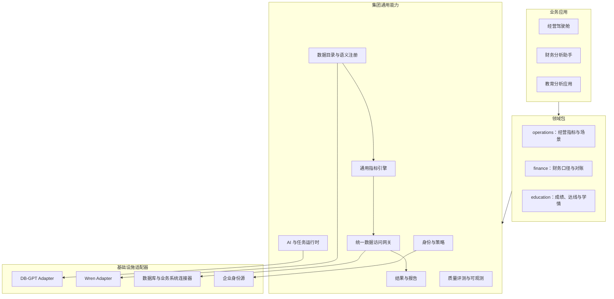

# 集团数据与 AI 底座：模块化建设方案

日期：2026-11-01。状态：架构提案，尚未实现或验证集成。首批领域：经营财务与教育分析。

2026-11-02 选型更新：当前采用 WrenAI 接入本项目，具体见[WrenAI 接入指南](wrenai-integration-guide.md)。下文 DB-GPT 适配器作为早期候选保留，当前实施范围不新增该运行时；通用模块与领域包边界继续适用。

本方案将此前的 DB-GPT + WrenAI + 教育指标方案提升为集团通用平台。通用指标引擎进入平台核心，教育指标成为领域包；经营、财务使用相同协议接入。此前方案中的教育计算、数据质量和结果一致性要求继续适用于教育领域。

## 1. 建设目标与边界

集团底座提供可组合、可单独使用的能力模块。各业务应用可以直接调用指标 API，也可以通过 AI 问数或固定报告使用相同指标。

模块独立意味着：有明确公共协议、可独立测试、可单独打包和发布、有模块自己的数据所有权，并能在满足依赖时被另一个应用使用。初期在同一仓库管理，通过进程内调用或服务适配器组合；按权限边界、依赖冲突、计算负载和团队归属决定独立部署。

首期交付范围是结构化经营财务分析与教育分析。企业知识问答、业务写操作和通用流程助手保留扩展协议，按实际业务需求增加对应能力与授权模型。

## 2. 四层架构



箭头为使用关系，并非强制的服务调用顺序。身份策略、观测、质量控制贯穿各条执行链路。业务应用只能经公开协议访问领域与平台能力。

## 3. 建议的独立模块

| 模块 | 核心职责与公共能力 | 可独立使用的场景 |
|---|---|---|
| platform-contracts / domain-sdk | QuerySpec、执行上下文、结果、领域包描述、事件、扩展接口 | 为多个业务应用提供稳定 SDK |
| identity-policy | 企业身份对接、租户、组织、工作空间、服务身份、数据策略决策 | 接入集团门户和其他业务系统 |
| data-gateway | 数据源连接、凭据引用、只读查询、事务、授权执行、超时、审计 | BI、报表、指标服务共用的访问入口 |
| semantic-registry | 数据集目录、粒度、关联、指标注册、版本发布、术语与语义模型 | 为 BI、API、AI 提供同一份业务定义 |
| metric-engine | 参数校验、指标依赖、聚合规则、确定性编译、复杂计算提供者 | 脱离 AI 直接查询经营或教育指标 |
| ai-runtime | 会话、候选需求解析、追问、任务执行、模型调用、工具选择 | 为不同业务应用提供 AI 分析入口 |
| artifact-engine | 事实结果存储、图表、报告、导出、证据引用与访问控制 | 固定经营报表、教育报告及 API 导出 |
| quality-evals | 数据契约检查、标准结果、回归题库、跨领域与跨版本验收 | 检验模块、领域包和上游适配器升级 |
| observability | trace、日志、执行成本、耗时与任务关联 | 统一定位查询、模型与业务规则问题 |

模块公共接口通过 contracts 表达。模块之间不导入对方的私有 ORM、数据库会话或内部函数；管理数据通过 API、公开服务接口或版本化事件交换。同一数据库实例可分 schema 部署，但各模块写入其拥有的数据。

日志与 trace SDK 是轻量依赖；业务模块不依赖评测运行器。quality-evals 在测试或发布阶段消费模块公共协议，避免形成依赖环。

## 4. DB-GPT 和 Wren 的位置

DB-GPT 是 ai-runtime 的首个实现适配器，提供工具调用和 AWEL 编排能力。平台会话、执行任务、权限、QuerySpec 和结果协议由平台拥有。具体工具包装支持函数扩展，适配方式以锁定上游版本为准。[DB-GPT 工具源码](https://github.com/eosphoros-ai/DB-GPT/blob/main/packages/dbgpt-core/src/dbgpt/agent/resource/tool/base.py)

Wren 是语义规划适配器，使用 semantic-registry 发布的 MDL；指标定义仍注册在平台语义注册中心。当前 WrenEngine 提供无数据库执行的 dry_plan 能力，适合部署为独立规划单元，计划交由 data-gateway 执行。[WrenEngine 源码](https://github.com/Canner/WrenAI/blob/main/core/wren/src/wren/engine.py)

平台接口先定义 SemanticPlanner 和 AgentRuntime 两类能力端口，再实现 DB-GPT、Wren 适配。领域包通过 SDK 声明能力，不导入 dbgpt、wren 或特定编排器。

初期每个 ai-runtime 采用一套顶层编排。复杂指标使用已注册确定性提供者；不必为普通指标额外创建多 Agent 流程。

## 5. 通用指标引擎与领域包

### 5.1 通用引擎掌握什么

引擎负责：维度、过滤、分组、时间窗口、指标依赖、单位与精度、可加性、比率汇总、排名比较池、执行计划、质量状态和事实结果。

总额可按允许维度汇总；比率按分子分母重算；去重人数需要保留去重总体；余额具有时间半可加性；排名、百分位等需要保留或重建比较总体。指标声明其支持的运算和维度，不能统一按 SUM 或 AVG 处理。

基于 SQL 的指标经认证逻辑模型编译；复杂指标实现 MetricProvider 协议。提供者选择由指标注册版本决定，模型不能传入任意代码或替换计算逻辑。

### 5.2 领域包声明什么

| 领域包 | 负责内容 | 首批示例 |
|---|---|---|
| operations | 经营对象、销售与客户维度、目标与预算场景、经营报告 | 销售订单额、目标完成率、客户结构 |
| finance | 法人、账簿、期间、金额口径、币种、回款、对账和合并规则 | 已确认收入、回款额、应收余额 |
| education | 考试、学校、班级、原始分/赋分、缺考、达线规则 | 均分、达线率、全市排名 |

相同业务指标使用一个认证标识。例如经营驾驶舱复用 finance.recognized_revenue；若合同金额与确认收入含义不同，使用不同标识并公开口径。跨领域引用声明指标和版本依赖，按数据授权解析，不直接导入另一个领域包内部代码。

领域包可包含模型映射、术语、实体解析器、指标定义、计算提供者、质量规则、工作流模板、报告模板和验收集。education 等字段不进入公共 contracts；领域特有参数通过注册 JSON Schema 校验。

下例为自有领域包清单草案，不是 DB-GPT 或 Wren 原生格式：

```yaml
id: finance
version: 1.0.0
requires:
  domain_sdk: ">=1.0,<2.0"
models: models/
metrics: metrics/
providers: [recognized_revenue_v1, receivables_balance_v1]
entity_resolvers: [legal_entity_v1, accounting_period_v1]
quality_rules: quality/
reports: reports/
evals: evals/
```

配置包和代码包区别发布。代码提供者通过审核的软件包或固定镜像交付，启动时注册；管理界面发布配置不触发任意脚本执行。各租户和工作空间显式启用允许的领域版本。

## 6. 统一指标契约与事实来源

模型只提出候选 QuerySpec。租户、身份、授权和有效领域版本由服务端上下文绑定。

```json
{
  "domain": "finance",
  "task": "metric_query",
  "metrics": [{"id": "finance.recognized_revenue", "version": 1}],
  "dataset_id": "dataset_demo",
  "time_range": {"start": "2026-10-01", "end_exclusive": "2026-11-01"},
  "dimensions": ["legal_entity_id"],
  "filters": [],
  "parameters": {
    "calendar_id": "calendar_demo",
    "currency_policy_id": "currency_policy_demo",
    "reporting_basis_id": "basis_demo"
  }
}
```

此例的参数必须通过 finance 对应指标的 Schema 与授权检查。它们是业务选择，不是通用引擎内置财务规则。数据集所属领域与可用指标决定路由；多领域存在同名术语时明确选择范围，不能仅按关键词访问数据。

semantic-registry 是定义唯一来源。人工审核的指标、实体、粒度与关联注册后，生成 Wren MDL、工具参数约束、检索描述和展示格式。可执行提供者由注册表引用其版本；避免手工维护多份计算公式。

每次发布使用 bundle_id 绑定领域版本、指标定义、语义模型、Wren MDL 哈希、计算提供者、视图和引擎兼容版本。metric-engine 执行时固定该版本。MetricResult 带指标、单位、样本/分子分母、实际范围、数据版本、质量状态和来源。

## 7. 经营财务首期的特殊要求

以下是需要业务确认的建模问题，具体财务口径由集团批准的制度、账簿和报表定义决定，模型不负责推导财务政策。

| 问题 | 领域包需明确的内容 |
|---|---|
| “收入”指什么 | 合同、订单、开票、确认收入分别建模；含税/不含税、含退回冲销等规则显式化 |
| 时间是哪一类 | 业务发生日、入账日、收款日、会计期间及截止时点分别声明 |
| 金额能否合计 | 单位、原币/本位币/报告币、汇率来源与版本；多币种金额先按批准规则转换 |
| 余额能否跨期相加 | 余额是时点指标；按时点取值和期间变化分析，不对多月余额直接 SUM |
| 单体与集团合并 | 法人范围、合并范围、内部交易和抵销规则明确；单体合计与合并报表不同指标 |
| 数据是否可复现 | 来源系统、数据批次、期间关闭状态、重述版本、期末快照记录完整 |
| 表关联会否放大金额 | 发票、订单、回款和凭证明细各自粒度清晰；先按正确业务键聚合再关联 |

对已发布报表冻结相应数据版本；新修正生成新结果并保留版本关系。金额使用确定精度类型与批准的舍入规则。对账用例在一致币种、期间和口径下检查总分、期初变动与期末关系；汇兑、重分类、冲销等调整按对应规则纳入。

## 8. 集团身份、组织与数据权限

区分 tenant（隔离边界）、organization（组织树）、workspace（协作空间）、legal_entity（业务法人）、dataset（授权数据资产）。组织与法人映射需要显式维护，不能从组织树推导财务合并范围。

集团、子公司、部门和业务系统的访问根据身份、数据资产、字段、记录范围、使用目的和服务身份共同决策。组织父子关系不自动授予全部明细权限；跨公司汇总与明细访问分别授权。

底座可对接集团现有身份系统与策略来源，并在 data-gateway 执行实际约束。数据源凭据由网关管理；AI 与 Wren 规划服务不获得业务库凭据。

元数据候选、指标计算、结果、导出、缓存与报告下载都检查权限。缓存绑定 tenant、授权范围指纹、权限版本、领域发布物和数据版本。跨源报表仅在源和快照兼容、授权完整时执行；不把跨源关联和分布式快照视为默认已支持能力。

## 9. 模块的组合方式

提供三种使用入口，底层消费相同指标和权限协议：

1. 指标模式：业务系统或 BI → Metric API → 语义规划/已注册提供者 → 网关 → 结果。
2. 固定报告模式：定时任务或业务接口 → ReportSpec → 指标计划 → 图表与导出。
3. AI 分析模式：问题 → 候选 QuerySpec → 确认和授权 → 同一指标链路 → 解释。

认证指标服务应能在无模型 API、无 DB-GPT 环境下测试和提供服务。固定报告可以完全依赖认证结果生成。AI 分析失败不会改变指标定义或将执行错误变为 0。

集团管理台配置身份映射、数据资产、领域启用、指标审核、版本发布、任务、成本和评测。各业务应用通过各自 BFF 或公共 API 组合能力，页面采用共享组件库；前端拆分按应用团队需要决定。

## 10. 仓库和部署建议

```text
platform-v2/
  packages/
    contracts/ domain-sdk/ identity-policy/ data-gateway/
    semantic-registry/ metric-engine/ artifact-engine/
    quality-evals/ telemetry-sdk/
  domains/
    operations/ finance/ education/
  adapters/
    dbgpt/ wren/ enterprise-identity/ connectors/
  apps/
    platform-api/ agent-worker/ semantic-service/
    group-console/ operations-app/ finance-app/ education-app/
  evals/ deploy/
```

初期同仓库、模块独立公共接口与版本发布。contracts 使用兼容性版本管理；模块及领域发布自己的版本，平台发行清单固定经过验证的组合。稳定后可按团队所有权拆仓，外部协议保持兼容。

首期三个独立运行单元足够承载主要能力：platform-api（目录、策略、指标、网关与结果）、agent-worker（DB-GPT）、semantic-service（Wren）。使用各自锁文件与镜像解决上游依赖差异。PostgreSQL、Redis、对象存储按基础设施配置。

data-gateway 在需要独立网络边界、连接治理或查询负载隔离时拆服务；报告渲染在大量导出时拆 worker；其余模块随规模扩展。进程内到远程调用使用相同业务契约和不同 transport adapter。

每个模块独立服务化时，必须补齐服务身份、超时、重试、幂等、事件投递、数据库迁移和运维归属。发布元数据的事件与状态写入采用可靠投递方案；查询结果与报表写入遵循幂等键。

## 11. 治理、测试和可观测

集团平台团队负责 contracts、身份策略、网关、语义注册、引擎与适配器；领域团队维护指标、数据映射、业务验收与领域模板。财务口径的发布需要业务负责人审核。模块维护者和指标负责人在注册信息中可查。

发布流水线包含：协议兼容、模块依赖检查、领域包兼容、固定数据标准结果、权限隔离、同一事实多入口一致性和回归集。应用核心禁止反向导入 education、finance 等领域实现，领域包不依赖 DB-GPT/Wren 的私有类型。

观测关联 trace_id、run_id、tenant_id、domain、metric_id、bundle_id、data_version、授权决策、查询计划与结果引用。运行日志按最小必要字段记录，不完整记录敏感明细。可采用 OpenTelemetry trace 关联跨单元请求、指标计算与模型调用。[OpenTelemetry traces](https://opentelemetry.io/docs/concepts/signals/traces/)

独立复用验收至少包含：

- 不安装教育包，经营财务应用可启动并查询认证指标。
- 不安装 DB-GPT，Metric API 和固定报告仍可工作。
- 使用另一规划适配器或测试实现时，指标的标准结果保持一致。
- 单独升级 education 领域包不改变 finance 的已固定口径与结果。
- 同一指标在 API、AI 回答和固定报告中使用相同版本并得出相同数值。
- 同名客户/学校、跨公司汇总、跨租户缓存和导出权限用例通过。

## 12. 分阶段交付

| 阶段 | 交付 | 验收重点 |
|---|---|---|
| P0：边界和基线 | contracts、领域 SDK 草案、数据目录、两领域指标与标准数据 | 公共协议无教育专有字段；业务定义得到确认 |
| P1：确定性核心 | identity-policy、data-gateway、semantic-registry、metric-engine 最小闭环 | 无 AI 可独立查询财务和教育指标 |
| P2：双领域包 | finance 的收入/回款/应收、education 的均分/达线/排名，经营应用复用 | 独立安装、版本固定、标准值与对账通过 |
| P3：开源能力接入 | DB-GPT Adapter、Wren Adapter、会话和任务恢复 | AI 和固定 API 复用同一执行链路 |
| P4：业务应用与治理 | 经营驾驶舱、财务分析、教育应用、版本审核和报告导出 | 应用独立组合模块；权限、回归和升级可验证 |

首批以两个差异明显的领域验证抽象。只有同一能力在多个领域出现，或已有明确集团使用方时，才抽为新的通用模块。当前文档交付边界和路线；具体集团身份源、ERP/财务系统、数据库、会计口径及接口兼容性需要在实施基线中核实。
