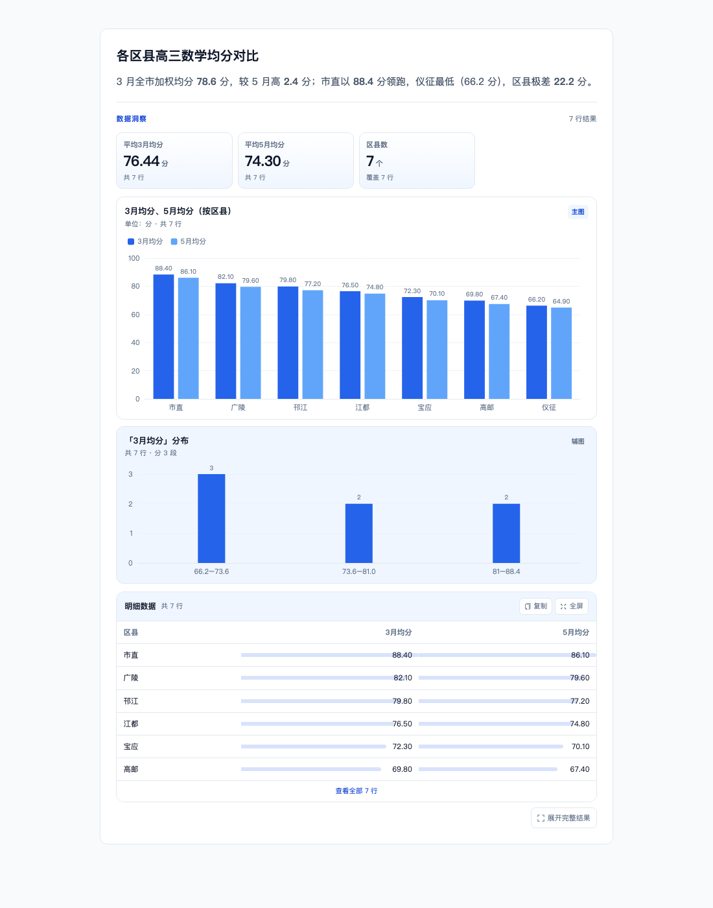
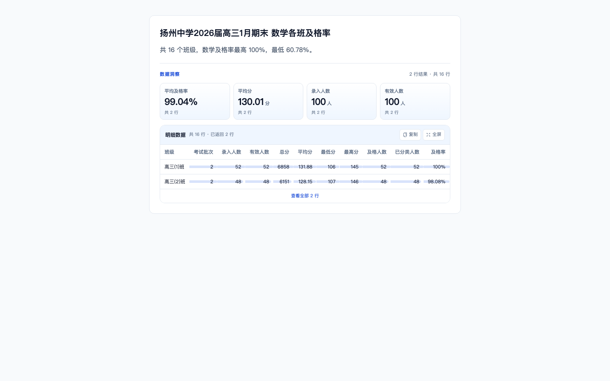
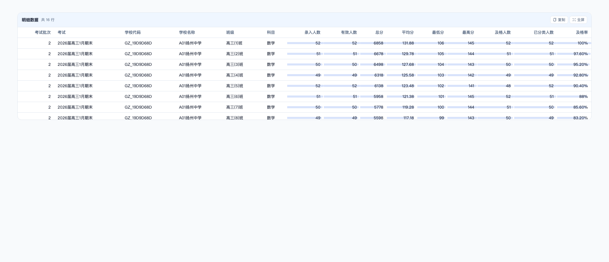

# 问答可视化 P0 落地说明

> 状态：P0 已完成 · 2026-11-11
> 方案：[qa-visualization-upgrade-plan.md](qa-visualization-upgrade-plan.md)
> 范围：ECharts 单栈、答案内「KPI + 1 主图 + 1 辅图」、8 类基础图、服务端兜底、增强明细表、历史数据兼容。



> 截图由独立渲染入口用演示数据生成，组件与正式页面一致；正式页面的 KPI、图表、表格均来自本轮查询结果。

---

## 1. 已交付

| 能力 | 实现 |
|------|------|
| ECharts 渲染 | 新增 `ChartView` / `echartsRuntime`，按需动态加载 `echarts/core`，不增加首屏图表库体积 |
| ChartSpec 协议 | 后端 `src/chat/service/chart_spec.py` + 前端 `components/charts/chartSpec.ts`，前后端共用同一套字段语义 |
| 自动选型 | 后端规则选型 + 模型 hint 校验 + 服务端兜底；前端保留同一套启发式，用于历史数据 / 旧后端 |
| 答案内分析卡 | `AnswerVisual`：KPI 条 + 主图 + 分布辅图 + 增强明细表 + 「展开完整结果」 |
| 8 类基础图 | KPI、柱状、横向条形、分组柱、堆叠柱、折线、面积、环形 / 表格 |
| 增强表格 | 排序、数值 / 百分比格式化、数据条、标记行高亮、复制 TSV、全屏 |
| 服务端兜底 | 模型不调用图表工具时，回合结束自动生成 spec 并推送 `chart` 事件 |
| 旧数据兼容 | 历史 `chart_config` 的 ECharts option 转 spec；失败时回退前端启发式 |
| 历史回放 | `useChat.loadConversation` 解析 spec；无 spec 的旧轮次仍可显示 KPI + 表格 |

---

## 2. 实际链路

```
query_semantic 成功
  ├─ SSE result → useChat.queryResults
  └─ 记录 last_result / last_result_index
        │
        ├─ 模型调用 chart_semantic_result
        │     └─ build_tool_chart_spec → validate → emit chart_spec
        │
        └─ 回合结束时仍无 chart
              └─ recommend_chart_spec → validate → emit chart_spec（兜底）
                    │
                    ▼
useChat.chartByRunId[runId] = { chartSpec, chartType, rawChartConfig }
                    │
                    ▼
CoworkChat → AnswerVisual
  ├─ resolveChartSpec(spec / legacyConfig / 前端启发式)
  ├─ KpiStrip
  ├─ ChartView（主图）
  ├─ ChartView（辅图：数值分布）
  └─ SmartTable
```

---

## 3. 新增 / 修改文件

### 后端

| 文件 | 说明 |
|------|------|
| `src/chat/service/chart_spec.py` | 新增：画像、意图分类、选型、校验、工具 spec 构建、ECharts option 兼容、旧 option 适配 |
| `src/chat/service/deepagents_runtime.py` | 图表工具改为产出 spec；记录 `last_result_index`；服务端兜底；按结果下标避免旧图覆盖新结果 |
| `tests/chat/test_chart_spec.py` | 新增 13 个纯函数用例 |
| `tests/chat/test_runtime_resilience.py` | 更新图表同批查询用例；新增「模型不画图时服务端兜底」用例 |

### 前端

| 文件 | 说明 |
|------|------|
| `src/components/charts/ChartView.tsx` | ECharts 容器：动态加载、resize、主题切换、错误降级 |
| `src/components/charts/echartsRuntime.ts` | 按需注册 Bar / Line / Pie + Grid / Tooltip / Legend / DataZoom / MarkLine / Aria |
| `src/components/charts/chartSpec.ts` | 类型、画像、校验、旧 ECharts option 适配 |
| `src/components/charts/chartTheme.ts` | 色板、字体、网格、tooltip、暗色 token |
| `src/components/charts/chartOption.ts` | ChartSpec → ECharts option（P0 基础图） |
| `src/components/charts/chartRecommend.ts` | 前端兜底选型、辅图生成、spec 解析入口 |
| `src/components/chat/AnswerVisual.tsx` | 答案内分析卡编排 |
| `src/components/chat/KpiStrip.tsx` | KPI 展示 |
| `src/components/chat/SmartTable.tsx` | 增强明细表 |
| `src/utils/chartKpi.ts` | KPI 派生规则（纯函数） |
| `src/components/chat/CoworkChat.tsx` | 在 `.cowork-answer` 内接入 `AnswerVisual` |
| `src/hooks/useChat.ts` | 解析 `chart_spec`，保存 spec / 原始 option，历史回放 |
| `src/api/adapter/chatAdapter.ts` | SSE `chart` payload 增加 `chart_spec` |
| `styles/cowork-chat.css` | Answer Visual / KPI / 图表卡 / 表格样式（含暗色） |

---

## 4. 行为边界

- **单值结果**：只出 KPI，不画柱状图。
- **明细 / 名单意图**：只出增强表格，不强行聚合。
- **排名意图**：条形长度 = 指标值，名次只做维度，不拿名次当柱高。
- **占比意图**：3~6 类且非负才出环形图；超过 6 类退化为横向条形。
- **趋势意图**：时间列 + 折线；两点数据由前端显示为折线（坡度图在 P1 评估）。
- **主图 + 辅图**：数据行数 > 6 且主图不是趋势图时，辅图为第一个数值列的分布（3~5 段）；否则只保留主图 + 明细表。
- **空结果 / 权限错误**：不渲染 `AnswerVisual`，沿用现有答案与权限卡片。
- **截断结果**：表格显示「共 N 行 · 已返回 M 行」，不把 `rowCount` 当成实际可展示行数。

---

## 5. 验证结果

| 检查 | 结果 |
|------|------|
| `npx tsc --noEmit` | 通过（顺带修复 `src/api/education.ts` 一个既有类型断言） |
| `npm run build` | 通过；`/chat` 首屏未引入 ECharts，图表为动态 chunk |
| `vitest`（图表 / 标签 / KPI / AnswerVisual 27 passed） | 通过 |
| `pytest tests/chat/test_chart_spec.py` | 13 passed |
| `pytest tests/chat/test_runtime_resilience.py tests/chat/test_chart_spec.py` | 82 passed（含新兜底 / ID 用例） |
| 实际组件截图 | 见 `docs/img/qa-viz-p0.png` |

已知既有问题（与本次改动无关）：

- `EduPermissionV2.test.tsx` 在本机超时失败（等待「管理权限 teacher」按钮）。
- 全量 `pytest` 有 14 个 collection error，原因是 `tests/chat/test_semantic_query.py` 导入不存在的 `_execution_error`；本次只运行了 `tests/chat` 中可收集的运行时用例。
- `npm run lint` 会进入 Next ESLint 初始化交互，仓库当前没有配置 `.eslintrc`；`next build` 已执行类型检查。

---

## 6. 未纳入 P0（按方案进入 P1/P2）

1. 图表工具栏：类型 / 维度 / TOP N / 标签 / 图例切换。
2. 导出 PNG、全屏图表、加入报告。
3. 组合图、散点、热力、雷达、子弹、仪表盘、漏斗、瀑布、桑基、树图。
4. `ChatExecutionPanel` 仍使用 G2；P1 迁移到 `ChartView` 后统一。
5. `pages/construct/education/line-reach.tsx` 仍使用 G2；迁移后再移除 `@antv/g2`。
6. 图与表联动（cross-filter）、埋点与选型命中率评测。

---

## 7. 试用方式

1. 启动后端与 `frontend-react`；
2. 在 `/chat` 提问一个返回多行的数据问题（如「对比各区县高三 3 月与 5 月数学均分」）；
3. 回答下方应出现「数据洞察」KPI、主图、分布辅图、明细表；
4. 若模型没有主动调用图表工具，服务端兜底仍应出图；
5. 打开历史会话，旧 `chart_config` 应能转 spec 或回退表格，不白屏。


---

## 8. 语义层英文字段中文化（2026-11-11 补充）

**现象**：`own_class_mean`、`school_grade_mean`，以及 `exam_batch_id`、`recorded_count`、`valid_count`、`total_score`、`average_score`、`min_score`、`max_score`、`pass_count`、`classified_count` 直接出现在 KPI 标题与明细表头；其中 `exam_batch_id` 还被当成数值指标，出现「最高exam_batch_id」。

**原因**：KPI 与表头统一走 `labelColumn`，但 `COLUMN_LABELS` 只收录了常见字段，语义层新字段没有映射，兜底返回原始列名。

**修复**：

- `columnLabels.ts` 增加 `own_class_mean` / `school_grade_mean` / `exam_batch_id` / `recorded_count` / `valid_count` / `total_score` / `average_score` / `min_score` / `max_score` / `pass_count` / `classified_count` 等精确映射；
- 增加「前缀 + 中间词 + 后缀」组合规则，例如 `own_class_pass_rate → 本班及格率`、`school_grade_excellent_rate → 年级优秀率`、`school_grade_rank → 年级排名`；
- **ID 字段识别**：`*_id` / `*_code` / `*_no` 统一按维度处理，不进入 KPI，也不允许作为图表 Y 轴；`exam_batch_id` 表头显示「考试批次」，不再出现「最高exam_batch_id」；
- **KPI 聚合修正**：`average_score` 显示「平均分」而不是「平均平均分」；`min_score/max_score` 显示「最低分/最高分」；KPI 优先展示比率 / 平均分 / 人数，避免被 ID、极值挤占；
- **不再依赖固定白名单**：新增通用词素翻译，任意 snake_case / camelCase 组合都能尝试组合出中文，例如 `foo_bar_count → 人数`、`custom_metric → 自定义指标`、`ownClassMean → 本班均分`；
- **残留兜底**：仍无法翻译的英文字段统一显示「字段」，原始字段名放到 KPI / 表头的 `title` 提示里，不再把英文直接铺在界面上；
- **图表标题兜底**：后端 spec 标题里若混入原始英文字段，前端 `specTitle` 用编码字段重建中文标题；
- KPI 与表头都复用该映射，历史会话无需重新查询即可生效；
- 增加 `columnLabels.test.ts`、`chartKpi.test.ts`、`chartSpec.test.ts` 与后端 `test_chart_spec.py` 用例，防止回归。



> 截图使用 `exam_batch_id` / `recorded_count` / `valid_count` / `total_score` / `average_score` / `min_score` / `max_score` / `pass_count` / `classified_count` 等原始字段渲染，确认 KPI、表头均已中文化，且 ID 不再进入 KPI。


---

## 9. 明细表视觉升级（2026-11-11 补充）

> 说明：明细表是 `SmartTable`（HTML），不是 ECharts；这里按图表卡片的视觉规范统一，避免卡片内「图很精致、表很素」。



本次调整：

- **表头**：浅蓝渐变底、品牌蓝文字、加粗、吸顶；数字列表头右对齐。
- **行**：斑马纹 + hover 高亮；首列吸附在左侧，横向滚动时不丢失行标识。
- **数字**：`tabular-nums` 等宽数字、右对齐、加粗；数据条改为低透明度渐变，弱化「长条压字」。
- **全屏弹窗**：宽度限制为 `min(94vw, 1680px)`，避免超宽屏把 15 列拉成一条条空白；增加「共 N 行 · M 列」信息条和复制按钮；表格区域独立滚动。
- **列名**：`school_id → 学校代码`、`school_name → 学校名称`，不再出现两个「学校」。
- **ID 列**：`exam_batch_id` / `考试批次` 等不画数据条，也不参与 KPI。
- **暗色**：全屏弹窗单独声明 `--cowork-*` 变量，避免 Modal 挂到 body 后变量丢失。
