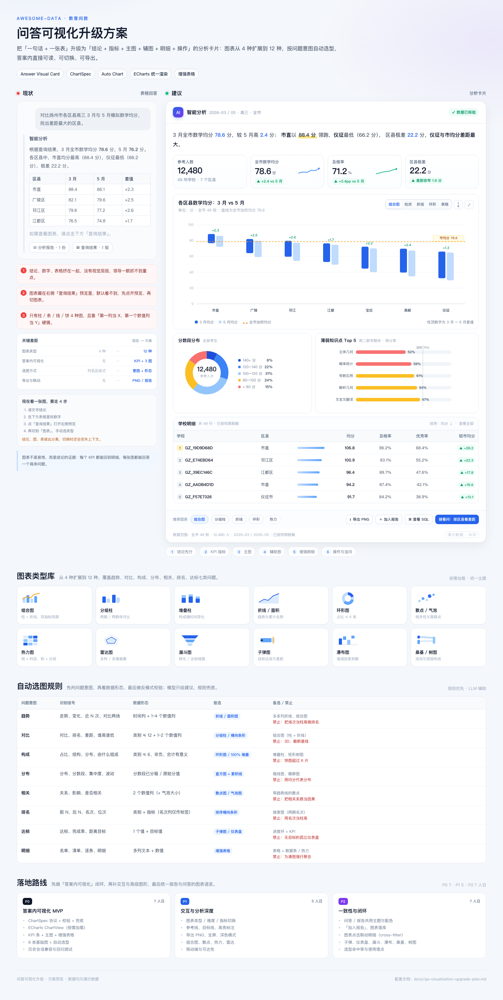

# 问答可视化升级方案（Answer Visual Card）

> 状态：方案稿 · 2026-11-11；P0 已落地，见 [qa-visualization-p0.md](qa-visualization-p0.md)。
> 范围：`frontend-react` 问答链路 + `src/chat` 图表协议；报告模板（iframe）只做主题对齐，不在本期重写。
> 目标读者：产品 / 前端 / 后端 / 设计 / QA。



> 可交互预览：[qa-viz-mockup.html](mockups/qa-viz-mockup.html)（数据均为演示数据）。

---

## 0. 一页结论

现在的问答是「一段 Markdown 结论 + 一张表」，图表被折叠在右侧「查询结果」预览里，只有柱 / 条 / 线 / 饼 4 种，且选型靠列名硬猜。用户要看完结论、再点开预览、再切图表，才能建立「数字 ↔ 图形」的联系。

本方案把每一轮回答升级为一张 **Answer Visual Card（分析卡片）**：

```
① 结论句（关键数字高亮）
② KPI 条（2~4 个指标 + 同比/对标 + 迷你趋势）
③ 主图（自动选型 + 参考线 + 标注）
④ 辅助图（分布 / 构成 / 薄弱项，≤2 张）
⑤ 明细表（数据条 / 排序 / 条件格式 / 全屏）
⑥ 操作条（切图 / 导出 PNG / 加入报告 / 继续追问）
⑦ 脚注（数据范围、口径、行数、水印）
```

三个关键决策：

| 决策 | 建议 | 理由 |
|------|------|------|
| 渲染器 | **ECharts 单栈**，按需加载，替换 `G2Chart` | 报告模板已经是 ECharts；热力 / 雷达 / 散点 / 漏斗 / 桑基 / 仪表盘原生支持；导出、`dataZoom`、`visualMap` 成熟 |
| 选型 | **规则引擎为主，LLM 只给 hint，服务端兜底必出 spec** | 不让模型幻觉列名；即使模型没调图表工具，也能稳定出图 |
| 交互 | **答案内 1 主图 + ≤2 辅图 + 明细；完整交互进预览面板** | 一屏可读，避免把聊天记录变成仪表盘堆叠 |

**不改什么（硬约束）：**

- 不改 SQL 语义、不新增数据拉取、不改 KPI 口径；图表只消费本轮 `query_semantic` 已返回的 `rows`。
- 权限、行级过滤、脱敏、水印沿用现有链路，图表不绕过 SQL 权限。
- 空数据 / 单值 / 权限错误不出图，不为了「有图」强行聚合。
- 不改报告模板的取数与业务逻辑；本期只统一图表主题与渲染器。

---

## 1. 现状盘点：三个断点

### 1.1 当前链路

```
用户提问
  └─ DeepAgents query_semantic（src/chat/service/deepagents_runtime.py）
       ├─ SSE result  → useChat.queryResults（原始 rows/columns）
       ├─ SSE chart   → useChat.chartByRunId（chart_type + ECharts option）
       └─ SSE report  → useChat.reports（HTML iframe）
            ↓
     CoworkChat（frontend-react/src/components/chat/CoworkChat.tsx）
       ├─ assistant 文本 → ReactMarkdown + eduMarkdownComponents（表格）
       └─ 产物按钮「查询结果」→ ChatExecutionPanel
            ├─ G2Chart：column / bar / line / pie
            └─ QueryResultTable：原生 <table> + 分页
```

### 1.2 代码证据

| # | 事实 | 位置 |
|---|------|------|
| 1 | 答案区只渲染 Markdown，图表不在答案里 | `CoworkChat.tsx:287-293`；图表入口在 `294-297` |
| 2 | 图表必须点开右侧预览才可见 | `CoworkChat.tsx:323-326`；`ChatExecutionPanel.tsx:561-615` |
| 3 | 前端只支持 4 种图 | `G2Chart.tsx:6`：`"column" \| "bar" \| "line" \| "pie"` |
| 4 | 后端推荐在前端被丢掉 | 后端发 ECharts option（`deepagents_runtime.py:790`），前端 `asChartConfig` 只认 `{x,y,title}`（`useChat.ts:103-111`） |
| 5 | 图表工具只允许 line / bar | `deepagents_runtime.py:753`：`kind: Literal["line", "bar"]` |
| 6 | 选型靠列名启发式 | `G2Chart.tsx:66-89`：第一个类别列当 X，数值列按「率 > 人数」打分当 Y |
| 7 | 17 种后端图表类型只在报告里用 | `src/agent/education/charts.py:33-51` |
| 8 | 明细表无排序 / 格式 / 条件格式 | `ChatExecutionPanel.tsx:73-136` |
| 9 | 问答用 G2，报告用 ECharts（CDN） | `G2Chart.tsx`；`src/agent/resource/templates/education/_base.html:23` |
| 10 | 历史落库只存 `chart_type` / `chart_config` | `src/chat/models/conversation.py:44-45`；`src/chat/schemas.py:197-238` |

### 1.3 具体问题

1. **图表默认不可见。** 结论在左，图在右侧抽屉；用户要建立「数字 ↔ 图形」联系，需要 3~4 次点击。
2. **类型太少。** 4 种图无法覆盖分布（分数段）、相关（均分 vs 及格率）、多维（六科画像）、达标（目标差距）、流向（名次变化）等教育场景。
3. **推荐协议断链。** 后端 `chart_semantic_result` 产出的是 ECharts `option`，前端 `ChartConfig` 只解析 `x/y/title`；`option` 里没有这三个键，`chartConfig` 直接变成 `undefined`。于是 `chart_type` 只剩一个步骤文案，实际图形完全由前端启发式重算。
4. **选型不懂问题。** 问「排名」和问「趋势」，只要列形状一样，就会被画成同一种图；名次列还可能被当成柱高，数值越大反而越「高」。
5. **图和结论不互证。** 结论里的数字、图里的点、表里的行没有共享高亮 / 联动；图只是「另一块内容」。
6. **表格太素。** 没有排序、单位、千分位、百分比、数据条、条件格式、TOP 高亮；数字列虽已右对齐，但读不出「谁高谁低、差距多少」。
7. **两套渲染器。** G2 与 ECharts 的字体、网格、色板、tooltip 不一致；报告依赖 jsDelivr，离线 / 导出时图表可能整块消失。
8. **没有导出与沉淀。** 图不能导出 PNG，不能加入报告，不能从图反查 SQL / 明细。
9. **移动端拥挤。** 预览是 Drawer，图表固定 340px；手机上图和表都局促。

---

## 2. 目标与设计原则

### 2.1 目标

> 让用户在答案卡片内 **3 秒看到结论、5 秒看懂图、1 次点击看到明细**；需要更深分析时，再进入预览面板。

可衡量的目标：

- 含数据结果的问答中，**≥80%** 在答案内出现至少 1 张图或 1 组 KPI；
- 图表推荐与人工期望的一致率 **≥75%**（用 30 条教育问题做评测集）；
- 「点开预览 → 切图表」的操作占比下降 **≥50%**；
- 单轮答案内图表数量 **≤3**，不出现「图表墙」。

### 2.2 原则

| 原则 | 落地方式 |
|------|----------|
| 结论先行 | 保留 / 强化 Markdown 结论；关键数字高亮；KPI 紧跟结论 |
| 一图一问题 | 每张图有明确标题 + 副标题（单位、口径、N）；不做「万能大屏」 |
| 数据可追溯 | KPI → 明细行 → SQL；图表值 = 结果行；不二次造数 |
| 渐进披露 | 答案内紧凑版；预览面板完整版；移动端折叠 |
| 规则优先 | 意图 + 数据形态 + 反模式校验；LLM 只做 hint，不做最终裁决 |
| 不发明数字 | 缺列就缺 KPI；缺数据就不出图；所有对比必须标明基准 |
| 一致性 | 问答 / 报告共用色板、字体、tooltip、空状态 |
| 可访问 | 颜色 + 形状 / 标签双编码；图表有文字摘要；键盘可操作 |
| 性能预算 | 图表库按需加载；点数封顶；表格虚拟化 |

---

## 3. 目标形态：Answer Visual Card

### 3.1 信息层级

```
┌──────────────────────────────────────────────────────────┐
│ ① 结论句：3 月市均分 78.6，较 5 月高 2.4；市直领跑…      │
│                                                          │
│ ② KPI：[参考人数 12,480] [均分 78.6 +2.4] [及格率 71.2%] │
│         [区县极差 22.2 收窄 1.8]                          │
│                                                          │
│ ③ 主图：各区县 3 月 vs 5 月均分（分组柱 + 市均分参考线）  │
│                                                          │
│ ④ 辅图：[分数段分布 环形] [薄弱知识点 Top5 横向条]        │
│                                                          │
│ ⑤ 明细：学校 | 区县 | 均分▂▂▂ | 及格率 | 优秀率 | 较市均分 │
│                                                          │
│ ⑥ 操作：[组合图][分组柱][折线][环形][表格]  导出 PNG  加入报告 │
│ ⑦ 脚注：全市 49 校 · 12,480 人 · 已按权限脱敏 · 水印       │
└──────────────────────────────────────────────────────────┘
```

### 3.2 三种密度

| 密度 | 触发条件 | 内容 | 说明 |
|------|----------|------|------|
| 简答 | 单值 / 是·否 / 1 行结果 | 结论 + KPI（最多 4 个）+ 可选子弹图 | 不为一个数字画柱状图 |
| 分析（默认） | 多行、1~2 个维度、1~3 个指标 | 结论 + KPI + 主图 + 1~2 辅图 + 明细 | 本方案主场景 |
| 报告 | 已生成 HTML 报告 | 结论摘要 + 报告 iframe + 「展开」 | 报告内图表不重复搬到答案里 |

### 3.3 放置与交互

- **答案内**：`CoworkChat` 的 `.cowork-answer` 区域，Markdown 结论之后、产物按钮之前。
- **主图高度**：桌面 280~320px；移动 220px；辅图 160~180px。
- **展开**：点击主图右上「全屏」或「展开」→ 现有 `ChatExecutionPanel`（桌面右侧面板 / 移动 Drawer），保留全部交互。
- **不重复**：多查询场景只对「最终查询集」出主图；其余查询集在下拉里切换，避免一轮出现 5 张图。
- **流式**：查询未完成时显示骨架屏；`result` 到达后一次性渲染，不随 token 重绘。

### 3.4 状态矩阵

| 状态 | 表现 |
|------|------|
| 查询中 | 骨架：KPI 占位 + 图表灰块 + 「正在取数…」 |
| 无数据 | 不显示图表区；结论说明「未查询到数据」；保留 SQL 入口 |
| 单行单值 | KPI 卡；可选子弹图 / 进度环；不画柱状图 |
| 行数截断 | 图注「基于前 N 行 / 已聚合」；表格脚注「共 M 行」 |
| 字段不足 | 只出表 / 只出 KPI；提示「缺少时间列，未生成趋势图」 |
| 权限错误 | 不出图；沿用现有权限错误卡片与修复建议 |
| 渲染失败 | 图区降级为「图表加载失败，查看数据表」；不阻塞答案 |

---

## 4. 图表体系

### 4.1 类型矩阵（P0 8 类 / P1 12 类 / P2 18 类；line/area 合并为 1 类）

| 类型 | 回答什么问题 | 数据条件 | 关键配置 | 交互 | 阶段 |
|------|--------------|----------|----------|------|------|
| KPI / 指标卡 | 现在是多少？比基准如何？ | 单值或可聚合单列 | 单位、对比基准、涨跌色 | 点击看明细 | P0 |
| 柱状图 column | 类别之间谁高谁低？ | 类别 ≤12，1~2 个指标 | 排序、基线 0、数值标签 | 切换排序 / 下钻 | P0 |
| 横向条形 bar | 排名 / 长标签 | 类别 >8 或名称长 | 降序、TOP N、名次标签 | 点击高亮 | P0 |
| 分组柱 grouped | 两期 / 两群体对比 | 1 维度 + 2 系列 | 系列色、组间距 | 图例开关 | P0 |
| 堆叠柱 stacked | 构成随时间 / 类别变化 | 1 维度 + 1 系列维度 | 堆叠、百分比 | 图例开关 | P0 |
| 折线 / 面积 line/area | 趋势、走势、拐点 | 时间列 + 1~6 系列 | 时间排序、空值断点、平滑慎用 | 缩放、十字线 | P0 |
| 环形图 donut | 占比 / 构成 | 非负、类别 ≤6、合计有意义 | 中心总量、百分比标签 | 图例开关 | P0 |
| 增强表格 table | 明细 / 名单 / 逐条 | 多列文本 + 数值 | 排序、数据条、条件格式 | 排序、全屏、复制 | P0 |
| 组合图 combo | 量 + 率同屏 | 时间 / 类别 + 2 个量纲 | 双轴、轴标题、系列归属 | 图例开关 | P1 |
| 散点 / 气泡 scatter/bubble | 相关、离群、分布 | 2 个数值列（+ 大小列） | 趋势线、气泡大小、透明度 | 框选、tooltip | P1 |
| 热力图 heatmap | 二维矩阵（班×科、校×分段） | 2 个维度 + 1 个指标 | 色阶、数值标签、缺失色 | hover 行列高亮 | P1 |
| 雷达图 radar | 多维画像（六科 / 能力） | 3~6 个维度、同一量纲 | 轴上限、对比系列 ≤3 | 图例开关 | P1 |
| 子弹图 bullet | 目标达成 / 差距 | 1 个值 + 目标值 | 目标线、区间带 | hover | P2 |
| 仪表盘 gauge | 单一达成率 | 0~100% 且目标明确 | 区间色、目标值 | hover | P2 |
| 漏斗图 funnel | 转化 / 达标链路 | 阶段有序、逐级递减 | 阶段名、转化率 | hover | P2 |
| 瀑布图 waterfall | 增减因素拆解 | 初始值 + 正负变化项 | 正负色、累计线 | hover | P2 |
| 矩形树图 treemap | 层级构成 | 两级以上层级 + 1 指标 | 层级、色阶 | 下钻 | P2 |
| 桑基图 sankey | 流向 / 转移 | 来源→目标 + 流量 | 节点宽、层级 | hover 路径 | P2 |

> 报告模板已有的 17 种 ECharts builder（`charts.py`）继续服务报告；问答侧只实现与「查询结果」匹配的 12 种，P2 再补高级图形。两边共享同一套主题 token。

### 4.2 自动选型

#### 第一步：识别问题意图（规则，零 LLM）

| 意图 | 关键词 / 信号 | 典型问法 |
|------|----------------|----------|
| 趋势 | 走势、变化、近 N 次、两场、同比、环比 | 「3 月到 5 月数学均分怎么变」 |
| 对比 | 对比、差距、谁高谁低、横向 | 「各区县数学均分对比」 |
| 构成 | 占比、结构、由什么组成、分布 | 「分数段人数占比」 |
| 分布 | 分布、集中度、波动、离散 | 「各班数学成绩分布」 |
| 相关 | 关系、影响、相关、是否 | 「均分和及格率有关系吗」 |
| 排名 | 前 N、后 N、名次、位次、TOP | 「数学均分前 10 的学校」 |
| 达标 | 达标、完成率、目标、临界 | 「距离 70% 及格率还差多少」 |
| 明细 | 名单、清单、逐条、明细 | 「列出临界生名单」 |

实现上复用 `ReportIntentResolver` 的关键词表（`src/agent/education/orchestrator.py`），但只取意图，不触发报告。

#### 第二步：数据画像

对 `columns + rows` 做纯函数画像：

- **时间列**：列名匹配 `时间|日期|月份|场次|考试|period|date|month`，或值可解析为日期 / 有序场次；
- **类别基数**：`distinct(x)`；
- **数值列**：全列可转 number / percent；
- **比率列**：列名含 `率|占比|比例|rate|ratio|pct`；
- **名次列**：列名含 `排名|名次|位次|rank|rk`；
- **负值 / 空值 / 重复维度**；
- **行数 / 是否截断**。

#### 第三步：候选打分

```
intent 匹配         +5
时间列 + 趋势       +4  → line / area
类别基数 3~12 + 对比 +3  → column
类别 > 12 + 排名     +3  → horizontal bar
非负 + 合计≈100%    +4  → donut / 100% stacked
2 个数值列 + 相关    +4  → scatter
1 个值 + 目标        +4  → bullet / gauge
2 维度 + 1 指标      +3  → heatmap（基数 >6）/ grouped（基数 ≤6）
多指标 + 同一实体     +2  → radar（≤6 维）
```

扣分 / 否决：

```
饼图切片 > 6           -10（改环形或条形）
系列 > 8               -8（TOP 8 + 其他）
Y 轴是名次列            -20（改表格 / 以指标为长度）
饼图含负值              -20（绝不）
柱状图基线不为 0        -10（强制归零或改点图）
折线 X 不是时间/有序     -8（改柱 / 坡度）
单行结果画柱状          -5（改 KPI / 子弹）
行数 > 500 未聚合       -6（先聚合 / 抽样）
```

#### 第四步：输出

```ts
type ChartPlan = {
  primary: ChartSpec;
  alternatives: ChartSpec[];   // 最多 3 个，用于切换
  reason: string;              // 「时间列 + 2 个系列 → 折线」
  confidence: number;          // 0~1，用于是否默认展开
};
```

#### 第五步：反模式修正（必须执行）

| 反模式 | 修正 |
|--------|------|
| 用名次当柱高 | 柱长 = 指标值；名次只做行标签 / 徽标 |
| 饼图 > 6 片 | 环形图 + 尾部合并「其他」，或横向条形 |
| 雷达 > 6 轴 | 拆成小倍数 / 条形对比 |
| 双轴无标签 | 左右轴都写指标名 + 单位；颜色对应系列 |
| 柱状图截断基线 | 强制 `yStartAtZero`；若差异太小，改用点图 / 差值图 |
| 3D / 阴影 / 渐变堆叠 | 禁用；统一扁平 |
| 只靠颜色区分 | 颜色 + 线型 / 标记 / 直接标签 |
| 折线平滑掩盖拐点 | 默认不平滑；只有明确趋势才允许 |
| 面积图堆叠负值 | 改分组面积 / 折线 |

### 4.3 视觉规范

| 项 | 规范 |
|----|------|
| 主色 | `#2563eb`；同系列浅色 `#60a5fa` / `#bfdbfe` |
| 语义色 | 正向 `#059669`；负向 `#dc2626`；警示 `#d97706`；中性 `#94a3b8` |
| 分类色板 | 8 色：蓝 / 青 / 紫 / 橙 / 绿 / 红 / 靛 / 灰；最多 8 系列 |
| 字体 | 轴 11~12px，标题 14px，KPI 24px；数字 `tabular-nums` |
| 网格 | 只保留水平网格 `#eef2f7`；无边框、无背景网格 |
| 图例 | 左上 / 顶部；≤6 项；优先直接标签 |
| Tooltip | 标题 + 值 + 单位 + N + 对比基准 |
| 暗色 | 用现有 CSS 变量映射；网格 `#1e293b`，文字 `#cbd5e1` |
| 色盲 | 避免红绿单独编码；用蓝/橙 + 标签；ECharts `decal` 可选 |
| 水印 | 导出 PNG 叠加用户名 / 时间；沿用 `stampHtmlWatermark` 思路 |

### 4.4 图标与图形语言

「图标更丰富」不只指图表类型，也包括卡片里的图形语言。统一规则：

| 场景 | 图形 | 规则 |
|------|------|------|
| 图表类型切换 | 20px 线性图标（柱 / 条 / 线 / 环 / 散点 / 热力 / 雷达） | 图标 + 文字，不单独用图标承载语义；选中态用蓝色底 |
| KPI 涨跌 | `▲ / ▼ / —` + 数值 | 颜色表示业务好坏，不机械红涨绿跌；必须带对比基准 |
| 状态标签 | 圆点 / 徽标（领先、落后、临界、下滑） | 颜色 + 文案双编码；最多 2 个标签，避免贴满 |
| 操作 | `@ant-design/icons` 线性图标（导出 / 全屏 / 加入报告 / 查看 SQL） | 16px；按钮高度 ≥32px；移动端 ≥44px |
| 空状态 | 轻量插画 / 线性图标 + 一句解释 | 不使用 emoji；给出下一步动作 |
| 图表内 | 参考线、目标线、标注点 | 线型 + 颜色双编码；标注文字 10~11px，避免遮挡 |

- 图标统一 1.5px stroke、`currentColor`，暗色自动适配；
- 图表类型图标与报告模板的图表标题图标共用一套 SVG（放 `src/components/charts/icons.tsx`）；
- 所有纯图标按钮必须有 `aria-label` / `title`。

---

## 5. 协议：ChartSpec

### 5.1 为什么不用 ECharts option 直传

| 问题 | 说明 |
|------|------|
| 渲染器耦合 | option 只能给 ECharts；以后换 G2 / 导出 / 报告复用都受限 |
| 前端丢失 | 当前 `ChartConfig` 只认 `{x,y,title}`，option 里的 `series/xAxis` 全部丢掉 |
| 难校验 | LLM 可以塞任意 option；列名、类型、行数无法在协议层约束 |
| 难测试 | 断言一张图的语义，比断言 option 的像素级字段稳定 |
| 难演进 | 加标注 / 排序 / TOP N 要改 option 结构，不如加 spec 字段 |

### 5.2 类型定义

```ts
export type ChartSpecType =
  | "kpi" | "column" | "bar" | "groupedColumn" | "stackedColumn"
  | "stackedBar" | "line" | "area" | "combo" | "pie" | "donut"
  | "scatter" | "bubble" | "heatmap" | "radar" | "funnel"
  | "gauge" | "bullet" | "waterfall" | "treemap"
  | "sankey" | "table";

export type ChartSpec = {
  version: 1;
  type: ChartSpecType;
  title?: string;
  subtitle?: string;
  dataset: {
    columns: Array<{
      name: string;
      label?: string;
      role: "dimension" | "measure" | "time";
      type: "string" | "number" | "percent" | "date";
      unit?: string;
      format?: string;          // "0.0" / "0%" / ","
    }>;
    rows?: Array<Array<string | number | null>>;  // 默认省略，用 source.resultIndex 引用
    rowCount?: number;
    truncated?: boolean;
  };
  encoding: {
    x?: string;
    y?: string[];
    series?: string;
    size?: string;
    color?: string;
    facet?: string;
  };
  transform?: {
    sort?: { by: string; order: "asc" | "desc" };
    topN?: number;
    otherLabel?: string;
    aggregate?: "sum" | "avg" | "count" | "min" | "max";
    stack?: boolean;
    normalize?: boolean;
    cumulative?: boolean;
  };
  annotations?: {
    referenceLines?: Array<{ axis: "x" | "y"; value: number | string; label?: string }>;
    target?: { value: number; label?: string };
    highlight?: Array<{ series?: string; x?: string; label?: string }>;
  };
  options?: {
    showLabel?: boolean;
    showLegend?: boolean;
    smooth?: boolean;
    yStartAtZero?: boolean;
    dualAxis?: boolean;
    palette?: string;
    valueSuffix?: string;
  };
  narrative?: { headline?: string; insight?: string; comparison?: string };
  source?: {
    resultIndex?: number;   // 对应 useChat.queryResults 的下标，避免重复传 rows
    queryKey?: string;
    sql?: string;
    rowCount?: number;
    truncated?: boolean;
    scope?: string;
  };
};
```

### 5.3 示例（分组柱 + 参考线）

> 示例为自包含形态（带 `dataset.rows`）；线上默认省略 `rows`，用 `source.resultIndex` 引用已有查询结果，避免大结果集在 SSE 中翻倍。

```json
{
  "version": 1,
  "type": "groupedColumn",
  "title": "各区县数学均分：3 月 vs 5 月",
  "subtitle": "单位：分 · 全市 49 校",
  "dataset": {
    "columns": [
      { "name": "region", "label": "区县", "role": "dimension", "type": "string" },
      { "name": "mar", "label": "3 月", "role": "measure", "type": "number", "unit": "分" },
      { "name": "may", "label": "5 月", "role": "measure", "type": "number", "unit": "分" }
    ],
    "rows": [
      ["市直", 88.4, 86.1],
      ["广陵", 82.1, 79.6],
      ["邗江", 79.8, 77.2]
    ],
    "rowCount": 7
  },
  "encoding": { "x": "region", "y": ["mar", "may"] },
  "annotations": {
    "referenceLines": [{ "axis": "y", "value": 78.6, "label": "市均分 78.6" }]
  },
  "options": { "showLabel": true, "yStartAtZero": true }
}
```

### 5.4 数据引用与体积

- `result` 事件已经发过完整 `rows`；`chart` spec **默认只带 columns + encoding + `source.resultIndex`**，不重复带 rows。
- 前端按 `source.resultIndex` 从 `queryResults` 取行；若 spec 自带 `dataset.rows`（聚合 / 抽样后 ≤200 行），优先使用 spec 的行。
- 排序 / TOP N / 百分比等转换默认在前端执行；只有跨行聚合（如先按区县汇总再画图）才由后端预计算并带小数据集。
- 校验时同时检查 `source.resultIndex` 是否越界、列名是否存在于该结果。

### 5.5 兼容旧数据

- 旧记录 `chart_config` 可能是 ECharts option（含 `series` / `xAxis` / `yAxis`）。
- 前端 `adaptLegacyChartConfig(record)`：
  1. 若 JSON 有 `version` 且 `type` 在允许列表 → 按 spec 渲染；
  2. 若像 ECharts option → 尽力转 spec；转不了就用 `recommendChartSpec(columns, rows)` 兜底；
  3. 都没有 → 表格。
- P0 **不新增数据库列**：spec 以 `{"kind":"spec","version":1,...}` 写回现有 `chart_config` JSON；`chart_type` 同步为 spec type。P2 如需独立查询再考虑迁移。

---

## 6. 前端实现

### 6.1 组件树

```
CoworkChat
  └─ .cowork-answer
      └─ AnswerVisual               ← 新增：答案内分析卡片
          ├─ InsightText            ← 复用 ReactMarkdown + eduMarkdownComponents
          ├─ KpiStrip               ← 新增：KPI 指标条
          ├─ ChartView              ← 新增：ECharts 渲染器
          ├─ MiniChartGrid          ← 新增：≤2 张辅图
          ├─ SmartTable             ← 新增：增强明细表
          └─ AnswerActions          ← 新增：切图 / 导出 / 加入报告 / 追问
```

> 当前真正被页面使用的是 `CoworkChat`（`pages/chat/index.tsx`）。`ChatContentContainer` / `OpenCodeSessionTurn` 这套旧入口当前未被页面引用，但代码仍在。P0 只接 `CoworkChat`；为避免两套渲染漂移，`AnswerVisual` 抽成无路由依赖的公共组件，P1 再评估旧入口复用或删除。

### 6.2 新增文件

| 文件 | 职责 |
|------|------|
| `src/components/charts/ChartView.tsx` | ECharts 容器：`spec` 入参、主题、resize、dispose、空状态、错误降级 |
| `src/components/charts/chartTheme.ts` | 色板、字体、网格、tooltip、暗色 token |
| `src/components/charts/chartSpec.ts` | TS 类型、运行时校验、旧 option 适配 |
| `src/components/charts/chartExport.ts` | `getDataURL`、水印、下载 PNG / 复制 |
| `src/utils/chartRecommend.ts` | 意图分类、数据画像、候选打分、反模式修正（纯函数） |
| `src/components/chat/AnswerVisual.tsx` | 答案卡片编排：结论 / KPI / 主图 / 辅图 / 表 / 操作 |
| `src/components/chat/KpiStrip.tsx` | KPI 计算与展示；无可用指标时返回 `null` |
| `src/components/chat/SmartTable.tsx` | 排序、格式、数据条、热力、全屏、复制 / CSV |
| `src/components/chat/ChartToolbar.tsx` | 图表类型、维度 / 指标、TOP N、标签、图例、导出 |

### 6.3 数据流

```
SSE result ──► useChat.queryResults（rows/columns）
SSE chart  ──► useChat.chartByRunId（spec）
                     │
                     ▼
CoworkChat ──► AnswerVisual
                 ├─ 有 spec → ChartView(spec)
                 ├─ 无 spec → recommendChartSpec(question, result)（前端兜底）
                 └─ spec 非法 → SmartTable + 「图表不可用」
```

### 6.4 渲染器

- 依赖：`echarts`（`echarts/core` + 按需 `BarChart/LineChart/PieChart/ScatterChart/HeatmapChart/RadarChart/GaugeChart/FunnelChart/...`）。
- 加载：`next/dynamic` + `IntersectionObserver`，只有卡片进入视口才加载图表 chunk；首屏不引入 ECharts。
- 生命周期：`init` 一次；`setOption(option, { notMerge: true })`；`ResizeObserver` 自适应；卸载 `dispose()`。
- 主题：`chartTheme.ts` 输出 base option；暗色跟随 `document.documentElement` 的 class / CSS 变量。
- 交互：`tooltip`、`legend`、`dataZoom`（折线 >20 点）、`visualMap`（热力）、`brush`（P2）。
- 降级：`try/catch` + `ErrorBoundary`；失败显示「图表加载失败」+ 数据表。

### 6.5 KPI 计算规则

只从「最终查询集」的结果列 / 行派生，且必须可解释：

| 场景 | 取值 |
|------|------|
| 单行 | 每个数值列 → 一个 KPI（最多 4 个） |
| 多行 + 趋势 | 最新一期值 + 与上一期差值 |
| 多行 + 对比 | TOP1 值 + 与第二名 / 基准的差距 |
| 多行 + 构成 | 合计 + 占比最高项 |
| 多行 + 排名 | 有「本班 / 标记」行则取该行；否则取 TOP1 |
| 分布 | 均值 / 中位数（若列存在）+ 样本数 |

- 允许的派生：`sum / avg / count / min / max / delta / share`，且必须在脚注注明「由明细计算」。
- 禁止的派生：跨查询拼接、用报告里的数字、凭标题猜指标。
- 每个 KPI 必须带单位；对比必须带基准名（「vs 5 月」「较市均分」）。
- 涨跌色只表示「业务好坏」，不机械用红涨绿跌（例如「差距收窄」是绿色）。

### 6.6 增强表格（SmartTable）

在现有 `QueryResultTable` 基础上升级：

- **类型推断**：数字 / 百分比 / 日期 / 文本 / 名次；
- **格式化**：千分位、1 位小数、`+/-` 带色、单位后缀；
- **条件格式**：数值列数据条；二维矩阵热力；TOP/BOTTOM 行高亮；「本班 / 标记」行高亮；
- **排序**：点击表头排序（数值按数值，文本按 locale）；
- **列**：首列粘性、表头粘性、列宽拖拽（P1）；
- **工具**：复制 TSV / 导出 CSV / 全屏 / 行数；
- **性能**：>200 行分页；>1000 行虚拟滚动（P1）；
- **移动**：横向滚动 + 右侧渐隐，优先保留前 3 列。

### 6.7 状态与偏好

- `chartByRunId[runId] = { spec, userType?, userEncoding? }`；
- 用户切图后写入 `userType`，不覆盖后端 spec；刷新 / 历史回放优先 `userType`；
- 全局偏好（是否默认展开图表、密度）存 `localStorage`，按用户隔离；
- 新 run 开始时重置临时覆盖，避免上一轮图表类型串到下一轮。

### 6.8 性能与可访问性

- 首屏 bundle 不增加：ECharts 动态 chunk；`ChartView` 用 `next/dynamic` 且 `ssr:false`。
- 点数封顶：折线 ≤500 点、分类 ≤50 类、散点 ≤2000 点；超出聚合 / 抽样并注明。
- 图表只在 `result` 到达后渲染，流式 token 不触发图表重绘。
- 图表容器 `role="img"` + `aria-label`（标题 + 关键结论）；下方提供「查看数据表」。
- 色板通过对比度检查；颜色 + 标签 / 线型双编码；键盘可聚焦工具栏。
- 暗色 / 高对比模式跟随现有主题；导出图片使用白底 + 水印。

---

## 7. 后端实现

### 7.1 新增模块

`src/chat/service/chart_spec.py`（纯函数，无 I/O）：

| 函数 | 职责 |
|------|------|
| `profile_result(columns, rows)` | 列画像：时间 / 类别基数 / 数值 / 比率 / 名次 / 空值 |
| `classify_intent(question, report_type)` | 复用教育意图关键词，返回 8 类意图 |
| `recommend_chart_spec(question, columns, rows, hint=None)` | 规则打分 + 反模式修正，返回 `ChartPlan` |
| `validate_chart_spec(spec, columns, rows)` | 列存在、类型匹配、系列数、行数、枚举白名单 |
| `spec_to_echarts_option(spec, rows)` | 渲染 / 导出 / 测试用；P2 报告可复用 |
| `adapt_legacy_chart_config(chart_type, chart_config)` | 旧 ECharts option → spec（尽力） |

与 `src/agent/education/charts.py` 的关系：

- `charts.py` 继续作为「报告 ECharts option builder」不动；
- `chart_spec.py` 只服务问答结果，复用其配色 / 数值格式约定；
- P2 再评估把报告 builder 收敛到 `spec → option`，避免一次性大改。

### 7.2 工具与 SSE 协议

现有 `chart_semantic_result(x_column, y_columns, kind: Literal["line","bar"], title)` 扩展为：

```python
@tool
async def chart_semantic_result(
    x_column: str,
    y_columns: list[str],
    kind: Literal[
        "line", "area", "bar", "column", "groupedColumn", "stackedColumn",
        "donut", "pie", "scatter", "heatmap", "radar", "bullet",
    ] = "column",
    title: str = "",
    unit: str = "",
    series_column: str | None = None,
    top_n: int | None = None,
) -> str:
    ...
```

- 校验：列必须存在；`y_columns` 必须数值；`series_column` 基数 ≤8；`top_n` ≤50。
- 产出：`ChartSpec`（新协议）+ 旧 ECharts option（P0 双发兼容）；`source.resultIndex` 指向本轮 `last_result` 在结果列表中的下标。
- 失败：返回明确错误，不改变 `last_result`。

SSE `chart` 事件：

```json
{
  "chart_type": "groupedColumn",
  "chart_spec": { "version": 1, "type": "groupedColumn", "...": "..." },
  "chart_config": "<旧版 ECharts option，P0 双发；P2 下线>"
}
```

- 前端优先 `chart_spec`；`chart_config` 保留旧 ECharts option，避免旧客户端白屏，P2 旧客户端下线后移除。
- spec 默认不带 rows，前端用 `source.resultIndex` 关联 `queryResults`；只有聚合 / 抽样结果才带小数据集。
- 同一轮去重：`(run_id, result_index)` 只发一次；用户切换图表不重新发 SSE。

### 7.3 服务端兜底（关键）

不能依赖模型一定调用图表工具。`query_semantic` 成功后：

1. 记录 `last_result`（已有）；
2. 回合结束时，如果本轮没有 `chart` 事件，且 `last_result` 有 ≥1 行：
   - `spec = recommend_chart_spec(question, columns, rows)`；
   - 校验通过则 `emit("chart", ...)`；
3. 如果结果不适合出图（单值 / 文本列 / 行数 0），不发。

这样即使模型只查数、不画图，前端也能拿到确定性 spec；LLM 的图表工具只负责「比规则更好的选择」，规则负责兜底。

### 7.4 持久化

- `ConversationRecord.chart_type`：写 `spec.type`；
- `ConversationRecord.chart_config`：写 `{"kind":"spec","version":1,...}`；
- 读取：`src/chat/crud/chat.py` / `src/chat/api/chat.py` 原样返回，前端适配；
- P0 不迁移；P2 如需按图表类型统计，再加 `chart_spec` 列 / 索引。

### 7.5 埋点与评测

记录（不采集数据内容）：

- `run_id`、`question_intent`、`recommended_type`、`final_type`（用户是否切换）、`render_ms`、`render_error`、`row_count`；
- 离线评测集：30 条教育问题 + 期望图表类型；每周回放，计算命中率；
- 用户切换率 >40% 的意图，回到规则表调整权重。

### 7.6 测试

- `tests/chat/test_chart_spec.py`：
  - 时间列 → line；单值 → kpi/bullet；名次列 → 表格 / 横向条；饼图 >6 → donut/条形；
  - 非法列 / 非数值 / 空 rows → 校验失败；
  - 旧 option → spec 适配。
- `tests/chat/test_chart_emit.py`：模型不调图表工具时，服务端仍发 spec；模型调了不重复发。
- 前端 `src/utils/chartRecommend.test.ts`：与后端规则对齐的黄金用例。
- 前端 `ChartView.test.tsx`：空 spec / 非法 spec / resize / 卸载不泄漏。
- 回归：现有 `G2Chart.test.ts` 的纯函数（`inferChartFields` / `pickYField` / `preferQueryTableOverChart`）迁移到 `chartRecommend`，保留断言。

---

## 8. 分阶段计划

> 估算按「1 前端 + 1 后端 + 0.5 设计 + 0.5 QA」并行；人日为工作量，非日历天。

| 阶段 | 范围 | 交付物 | 主要文件 | 人日 | 退出标准 |
|------|------|--------|----------|------|----------|
| **P0** | 答案内可视化 MVP | ChartSpec 协议 + 校验 + 兜底；ECharts `ChartView`；KPI + 主图 + 增强表；8 类基础图；`CoworkChat` 接入；旧数据兼容 | 后端 `chart_spec.py`、`deepagents_runtime.py`；前端 `ChartView`、`AnswerVisual`、`KpiStrip`、`SmartTable`、`chartRecommend` | 7 | 10 条黄金问题中 ≥8 条出对图；KPI 与表格一致；历史会话可打开；现有测试全绿 |
| **P1** | 交互与分析深度 | 图表工具栏（类型 / 维度 / TOP N / 标签 / 图例）；组合图、散点、热力、雷达；参考线 / 目标线；导出 PNG；暗色 / 移动端 / 可达性 | `ChartToolbar`、`chartExport`、`chartTheme`；`ChatExecutionPanel` 改造 | 5 | 12 种图可用；桌面 / 移动 / 暗色三套截图验收；键盘可切换 |
| **P2** | 一致性与闭环 | 问答 / 报告共用主题；「加入报告」；图表点击联动明细；子弹 / 仪表盘 / 漏斗 / 瀑布 / 桑基 / 树图；埋点与评测；报告 ECharts 本地化（去 CDN） | `chartSpec` 共享、报告模板 `_base.html`、埋点 | 7 | 报告与问答色板 / tooltip 一致；图表可加入报告；离线报告图表可用 |
| **P3** | 体验增强（backlog） | 自然语言改图（「改成折线」「只看前 5」）；仪表盘收藏；定时快照；图表注释协作 | — | — | 按需排期 |

**依赖顺序：**

1. 产品确认渲染器（ECharts）与密度默认值；
2. 后端先落 `ChartSpec` + 兜底（前端可先用 mock spec 并行）；
3. 设计给色板 / 字号 / 空状态 / 移动端标注；
4. 前端接入 `CoworkChat`；
5. QA 用 10 条黄金问题 + 3 个断点回归。

---

## 9. 验收标准

### 9.1 功能用例（黄金集）

| # | 提问 | 期望 |
|---|------|------|
| 1 | 全市高三 3 月数学平均分是多少？ | KPI 卡（单值），不画柱状图 |
| 2 | 对比各区县高三 3 月与 5 月数学均分 | 分组柱，降序，市均分参考线 |
| 3 | 某校高三 3 月 → 5 月数学均分走势 | 折线 / 坡度图，按时间排序 |
| 4 | 高二数学期末分数段分布 | 直方图 + 累积线 |
| 5 | 高二数学期末及格率偏低的区县 | 横向条形，阈值线，非饼图 |
| 6 | 各校数学均分前 10 | 横向条形按指标排序，名次只做标签 |
| 7 | 各班 × 学科均分 | 热力图（基数大）/ 分组柱（基数小） |
| 8 | 学生六科画像 vs 班均 | 雷达图（≤6 轴）+ 对比条 |
| 9 | 列出临界生名单 | 仅增强表格，不强行出图 |
| 10 | 无数据 / 权限不足 | 空状态 / 权限卡片，不出图 |

### 9.2 数据正确性

- 每个 KPI 能在明细表中找到对应值（或注明聚合口径）；
- 图表 series 的值 = 结果行值，不二次换算（百分比列不再乘 100）；
- 排序、TOP N、其他合并后的合计与原始行数一致；
- 截断 / 抽样必须在图注与脚注同时标注。

### 9.3 视觉与体验

- 1440 / 1024 / 390 三个宽度截图通过设计评审；
- 浅色 / 暗色对比度 ≥4.5:1（正文）；
- 答案内图表 ≤3 张；主图不横向溢出；移动端工具栏可横向滚动；
- 空状态、加载骨架、错误降级三态齐全。

### 9.4 性能

- 图表 chunk 懒加载，首屏 JS 增量 ≤30KB gzip；
- `result` 到达后主图首帧 ≤300ms（1,000 行以内）；
- 表格 1,000 行滚动不掉帧；图表 resize 不闪烁；
- 卸载 / 切会话无 ECharts 实例泄漏。

### 9.5 兼容与回归

- 旧会话（`chart_config` 为 ECharts option）可正常打开；
- 无 `chart` 事件的历史轮次走前端兜底，不报错；
- 现有前端 `vitest`、后端 `pytest` 全绿；
- `npm run typecheck`、`npm run lint` 通过。

---

## 10. 风险与对策

| 风险 | 影响 | 对策 |
|------|------|------|
| ECharts 体积 | 首屏变慢 | 按需 + 动态 chunk + 视口加载；对比迁移前后 bundle |
| 双渲染器过渡 | 维护两套图表代码 | P0 只接 `CoworkChat`；P1 迁移问答侧；`pages/construct/education/line-reach.tsx` 仍用 G2，待其迁移后 P2 再移除 `@antv/g2` |
| LLM 给错列 / 错类型 | 图渲染失败或误导 | 服务端 `validate_chart_spec`；非法就回退规则 spec / 表格 |
| 答案被图表淹没 | 阅读体验下降 | 密度规则（1 主 + ≤2 辅）；可折叠；用户偏好 |
| 「图表说谎」 | 决策误判 | 反模式校验：名次不当长度、饼图 ≤6、柱基线 0、双轴标注 |
| 大数据量 | 渲染卡顿 | 点数封顶、聚合、抽样、注明；>500 行走表格分页 |
| 报告 CDN 依赖 | 离线 / 导出图表消失 | P2 将 ECharts 放 `public/vendor` 或内联；`_base.html` 改本地引用 |
| 旧数据格式 | 历史会话白屏 | `adaptLegacyChartConfig` + 前端兜底 + 回归用例 |
| 旧入口分叉 | 两套 UI 行为不一致 | `AnswerVisual` 无路由依赖；P1 评估旧入口复用或删除 |
| 范围蔓延 | P0 延期 | P0 锁定 8 类图 + 3 个断点；高级图进 P1/P2 |

---

## 11. 待确认

1. **渲染器**：是否同意 ECharts 单栈（新增 `echarts`，P2 迁移 `line-reach` 后移除 `@antv/g2`）？若坚持 G2，类型库需缩减到 G2 原生能力，或引入 `@antv/g2-extension-plot`。
2. **答案内默认密度**：默认「KPI + 1 主图 + 1 辅图」，还是「KPI + 主图」其余折叠？
3. **首屏预算**：图表 chunk 增量上限是否接受 30KB gzip / 懒加载？
4. **「加入报告」范围**：P2 只支持 PNG 插入，还是同时支持图表 spec 落库、报告内重新渲染？
5. **报告 CDN 本地化**：是否纳入本期 P2（会影响报告 HTML 体积与离线能力）？
6. **抽样策略**：超过 500 行时，前端抽样还是后端聚合？建议后端聚合、前端只负责展示。
7. **是否保留饼图**：建议默认环形图；饼图仅在 ≤4 片且用户主动切换时提供。

---

## 附录 A：教育问题 → 图表选型示例

| 问题 | 意图 | 结果形态 | 主图 | 辅图 / 备注 |
|------|------|----------|------|-------------|
| 全市高三 3 月数学平均分 | 单值 | 1 行 1 列 | KPI | 不画图 |
| 各区县 3 月 vs 5 月数学均分 | 对比 | 7 行 × 3 列 | 分组柱 + 参考线 | 差值条 / 表 |
| 某校近两次考试数学均分 | 趋势 | 2 行 × 2 列 | 坡度图 / 哑铃图 | 不用 2 点折线 |
| 高二数学期末分数段分布 | 分布 | 分段 × 人数 | 直方图 + 累积线 | 及格线参考 |
| 各校数学均分前 10 | 排名 | 10 行 × 2 列 | 横向条形（按均分） | 名次只做标签 |
| 各班 × 学科均分 | 二维对比 | 20 班 × 9 科 | 热力图 | 分组柱（班少时） |
| 学生六科 vs 班均 | 多维画像 | 6 科 × 2 系列 | 雷达图 | 对比条 |
| 临界生名单 | 明细 | 多列文本 | 增强表格 | 不聚合 |
| 及格率距离 70% 目标 | 达标 | 1 值 + 目标 | 子弹图 | 进度环 |
| 名次从 3 月到 5 月的变化 | 流向 | 两期名次 | 坡度图 | 桑基（P2） |

## 附录 B：涉及文件清单

**前端（新增）**

- `frontend-react/src/components/charts/ChartView.tsx`
- `frontend-react/src/components/charts/chartTheme.ts`
- `frontend-react/src/components/charts/chartSpec.ts`
- `frontend-react/src/components/charts/chartExport.ts`
- `frontend-react/src/components/chat/AnswerVisual.tsx`
- `frontend-react/src/components/chat/KpiStrip.tsx`
- `frontend-react/src/components/chat/SmartTable.tsx`
- `frontend-react/src/components/chat/ChartToolbar.tsx`
- `frontend-react/src/utils/chartRecommend.ts`

**前端（修改）**

- `frontend-react/package.json`：新增 `echarts`；`@antv/g2` 暂留（`pages/construct/education/line-reach.tsx` 仍在使用），P2 迁移后清理。
- `frontend-react/src/hooks/useChat.ts`：`ChartSpec` 类型、SSE 解析、`chartByRunId` 结构。
- `frontend-react/src/api/adapter/chatAdapter.ts`：`onChart` payload 增加 `chart_spec`。
- `frontend-react/src/components/chat/CoworkChat.tsx`：答案区接入 `AnswerVisual`。
- `frontend-react/src/components/chat/ChatExecutionPanel.tsx`：图表 / 表格替换为 `ChartView` / `SmartTable`（P0 保留旧组件兜底）。
- `frontend-react/styles/cowork-chat.css`、`globals.css`：卡片、KPI、表格、工具栏样式。
- `frontend-react/src/components/chat/G2Chart.tsx`：P1 标记 deprecated；`line-reach` 迁移完成后 P2 删除。

**后端（新增 / 修改）**

- 新增 `src/chat/service/chart_spec.py`。
- `src/chat/service/deepagents_runtime.py`：图表工具扩展、兜底 emit、去重。
- `src/chat/schemas.py`：`chart_spec` 字段。
- `src/chat/crud/chat.py`、`src/chat/api/chat.py`：落库 / 读取兼容。
- `src/chat/models/conversation.py`：P0 不改；P2 视需要加列。
- `src/agent/education/charts.py`：P0 不改；P2 共享主题 / spec 适配。

**测试**

- `tests/chat/test_chart_spec.py`
- `tests/chat/test_chart_emit.py`
- `frontend-react/src/utils/chartRecommend.test.ts`
- `frontend-react/src/components/charts/ChartView.test.tsx`
- 迁移 / 保留 `frontend-react/src/components/chat/G2Chart.test.ts` 的纯函数断言。

## 附录 C：方案预览

- 图片：`docs/img/qa-viz-mockup.png`
- 可交互 HTML：[qa-viz-mockup.html](mockups/qa-viz-mockup.html)
- 数据均为演示数据，不代表真实业务口径。

## 附录 D：3 分钟评审路径

1. **30 秒看现状**：左侧「现状」卡片，指出图表藏在「查询结果」预览里，且只有 4 种图；
2. **60 秒看方案**：右侧「建议」卡片，从 ① 结论到 ⑦ 脚注逐层讲，重点讲 KPI 和主图；
3. **60 秒看规则**：翻到「图表类型库」和「自动选图规则」，说明「排名不拿名次当柱高」「饼图 ≤6 片」等硬规则；
4. **30 秒确认**：只请评审确认三件事——渲染器 ECharts、答案内默认密度、P0 范围（8 类图 + 3 个断点）。
